# GMS Enterprise Master Documentation

This document is the authoritative technical book for the current GMS Enterprise codebase. It was written from the current repository state, with existing documentation used only as supporting context. When older docs disagree with executable code, this document trusts the code and calls out the discrepancy.

## Table Of Contents

- Foreword
- Chapter 1: The Big Picture
- Chapter 2: The Codebase Map
- Chapter 3: How It Starts - Boot Sequence And Entry Points
- Chapter 4: The Data Layer
- Chapter 5: The Core Business Logic
- Chapter 6: APIs And Interfaces
- Chapter 7: The Outside World - Integrations And Config
- Chapter 8: Infrastructure And Deployment
- Chapter 9: Testing
- Chapter 10: Developer Guide - Day-To-Day Work
- Chapter 11: Gotchas, Sharp Edges And Tech Debt
- Chapter 12: Frontend Architecture
- Appendix

---

## Foreword

GMS Enterprise is a visitor and access-management portal for ExampleCorp-style office operations. It lets guests book visits, hosts approve or coordinate those visits, reception teams check people in, admins manage organization data, and operations staff monitor queues, integrations, and reports. The system also provisions access credentials, sends notifications, tracks approvals, handles QR/PIN fallback, and can integrate with UniFi Access for physical access events.

The users are role based:

| User | What They Do |
|---|---|
| Guest | Registers, verifies account, books visits, views QR credentials, responds to reschedule/reassignment proposals, submits feedback. |
| Host / Super Host | Owns availability, approves visits, reassigns or reschedules, receives arrival notifications, sees host reports. |
| Reception / Super Reception | Operates check-in, watches escalations, manually checks in when UniFi is unavailable, manages guest-facing coordination. |
| Admin / Super Admin | Manages users, offices, departments, services, hosts, imports organization data, reviews operations and integration health. |

Architecturally, this is a pragmatic modular monolith: one Express API process, one Next.js frontend, one PostgreSQL database, one Redis-backed background and realtime layer, plus a separate worker process in Docker/production. The backend is organized by domain modules under `backend/src/modules`, with shared infrastructure under `backend/src/infrastructure` and cross-cutting middleware under `backend/src/shared`. The code is not microservices; it uses module boundaries, transactions, an outbox table, and queue dispatching to get many of the reliability benefits without deploying many services.

The north star: a visit is the central business object. Almost everything either creates, validates, schedules, approves, checks in, provisions, notifies about, or reports on a visit. When confused, trace the visit through these layers:

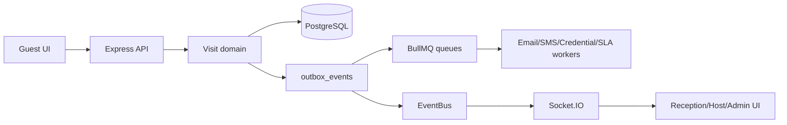

This document was synthesized from `README.md`, the per-module READMEs under
`backend/src/modules/`, and the source itself. It also cited a `docs/` tree (an
architecture document and codebase, developer, testing, deploy and unifi folders) and a
backend outbox-worker document. **None of those exist in this repo**; `docs/` contains
`TEST_STATUS.md`, the documentation index and the licensing contract
(`operations/PLATFORM-LICENSING.md`). Those citations
were removed on 2026-09-06. **The executable source is the authority**, and that
matters more here than usual: this file is long and parts of it have drifted.

---

## Chapter 1: The Big Picture

GMS is split into four runtime concerns:

1. The frontend is a Next.js App Router application in `frontend/app`. It has role-specific workspaces: `/dashboard` for guests, `/host`, `/reception`, and `/admin`. Feature API wrappers live in `frontend/features/*/api.ts`; shared HTTP and realtime behavior live in `frontend/shared/lib/api-client.ts` and `frontend/providers/RealtimeBridge.tsx`.
2. The backend API is an Express 5 application in `backend/src/app.ts`, started by `backend/src/main.ts`. It exposes versioned routes under `/api/v1`.
3. PostgreSQL is the durable source of truth. Sequelize models live under `backend/src/infrastructure/database/models`; migrations live under `backend/src/core/db/migrations`.
4. Redis supports BullMQ queues, optional caching, rate limiting backing, and Socket.IO horizontal fan-out.

Full system architecture:

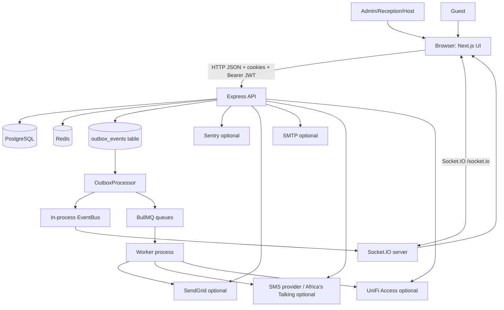

Every box:

| Box | Code Location | Responsibility |
|---|---|---|
| Browser / Next.js UI | `frontend/app`, `frontend/features`, `frontend/shared` | Renders role workspaces, calls API, stores auth state, connects to realtime events. |
| Express API | `backend/src/main.ts`, `backend/src/app.ts`, `backend/src/api/v1/index.ts` | HTTP surface, middleware, route mounting, boot lifecycle, graceful shutdown. |
| PostgreSQL | `backend/src/infrastructure/database/sequelize.ts` | Persistent relational state: users, visits, slots, approvals, credentials, outbox, etc. |
| Redis | `backend/src/infrastructure/cache/redis.client.ts` | Optional runtime acceleration: cache, queues, Socket.IO adapter. Code fails open in several places when Redis is absent. |
| Outbox | `backend/src/infrastructure/events/outbox.service.ts` | Transactional event/job persistence so side effects happen after database commits. |
| BullMQ workers | `backend/src/infrastructure/queue/workers` | Email, SMS, reminders, expiry, credentials, SLA, reception SLA, no-show processing. |
| Socket.IO | `backend/src/infrastructure/websocket/socket.ts` | Authenticated realtime rooms for user, office, and visit events. |
| External services | `backend/src/shared/services`, `backend/src/infrastructure/unifi` | SendGrid, SMTP, SMS, Sentry, Web Push, OCR, UniFi Access. |

Main booking/request flow:

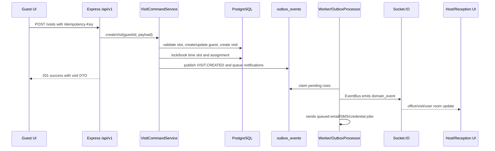

The code that proves the versioned API mount is in `backend/src/app.ts`:

```ts
app.use(appConfig.api.basePath, apiV1Routes);
app.use(errorHandler);
```

The domain routes are mounted in `backend/src/api/v1/index.ts`:

```ts
router.use('/auth', authRoutes);
router.use('/users', userRoutes);
router.use('/visits', visitRoutes);
router.use('/offices', officeRoutes);
router.use('/checkin', checkinRoutes);
router.use('/departments', departmentRoutes);
router.use('/services', serviceRoutes);
router.use('/hosts', hostRoutes);
router.use('/notifications', notificationRoutes);
router.use('/availability', availabilityRoutes);
router.use('/approvals', approvalRoutes);
router.use('/credentials', credentialRoutes);
router.use('/guests', guestRoutes);
router.use('/operations', operationsRoutes);
router.use('/integrations/unifi', unifiWebhookRoutes);
router.use('/ocr', ocrRoutes);
router.use('/simulation', simulationRoutes);
```

---

## Chapter 2: The Codebase Map

The repository is a monorepo with root orchestration, a backend package, a frontend package, docs, deployment assets, tools, generated build output, and data templates.

Directory tree, annotated:

```text
.
|-- .github/                         # GitHub Actions CI pipeline.
|   `-- workflows/phase2-validation.yml
|-- backend/                         # Express, Sequelize, workers, migrations, tests.
|   |-- certs/                       # Local HTTPS cert material.
|   |-- deploy/                      # PM2 and systemd-style worker deployment files.
|   |-- dist/                        # Compiled JS build output; do not hand-edit.
|   |-- docs/                        # Backend-specific architecture and edge-case notes.
|   |-- load-tests/                  # k6/load scripts for auth, approvals, check-in.
|   |-- logs/                        # Runtime logs when local logging writes files.
|   |-- scripts/                     # DB, seed, OpenAPI, simulation, backup, env scripts.
|   |-- src/
|   |   |-- api/                     # Version routers and Swagger spec assembly.
|   |   |-- bin/                     # Standalone process entry points, currently outbox worker.
|   |   |-- config/                  # Env schema and normalized app config.
|   |   |-- core/                    # Errors, DB migrations, logger, state machine, utilities.
|   |   |-- infrastructure/          # Concrete adapters: DB models, Redis, queues, email, SMS, UniFi, sockets.
|   |   |-- modules/                 # Business domains: auth, visits, services, scheduling, etc.
|   |   |-- seeders/                 # Sequelize seed data.
|   |   |-- shared/                  # Middleware, auth role helpers, common services.
|   |   |-- tests/                   # Jest test suite and helpers.
|   |   `-- types/                   # Express and library declaration merging.
|   |-- Dockerfile
|   |-- jest.config.js
|   |-- package.json
|   `-- tsconfig.json
|-- deploy/                          # Apache and quick-start deployment notes.
|-- docs/                            # Human documentation, OpenAPI spec, runbooks, guides.
|-- frontend/                        # Next.js app.
|   |-- app/                         # App Router pages and layouts by role.
|   |-- deploy/                      # PM2 frontend deployment config.
|   |-- features/                    # Feature-specific API wrappers, hooks, types, components.
|   |-- providers/                   # React providers including realtime and theme bridges.
|   |-- public/                      # Static assets and service worker.
|   |-- scripts/                     # Env/bootstrap scripts for Next.
|   |-- shared/                      # Common components, hooks, API client, role/status utilities.
|   |-- state/                       # Zustand stores.
|   |-- tests/                       # Node built-in frontend sanity tests.
|   |-- Dockerfile
|   |-- next.config.js
|   |-- package.json
|   `-- tailwind.config.js
|-- Templates/                       # Spreadsheet templates for bulk import workflows.
|-- tools/                           # Repo-level setup, OpenAPI comparison, test runners.
|-- docker-compose.dev.yml           # Local Postgres + Redis only.
|-- docker-compose.yml               # Full production-like Docker stack.
|-- package.json                     # Monorepo scripts.
`-- README.md                        # Quick project overview.
```

Where to put new code:

| Need | Put It Here | Avoid |
|---|---|---|
| New backend domain endpoint | `backend/src/modules/<domain>` plus route mount if new domain | Putting business logic in `app.ts` or `api/v1/index.ts`. |
| New Sequelize table | Model in `backend/src/infrastructure/database/models`, migration in `backend/src/core/db/migrations` | `sequelize.sync()` or hand-changing DB without migration. |
| New frontend page | `frontend/app/<role-or-route>/page.tsx` | Burying route pages under `features`. |
| New frontend API calls | `frontend/features/<domain>/api.ts` | Calling axios directly from many components. |
| Shared frontend UI | `frontend/shared/components` | Copy/pasting UI across role pages. |
| Cross-cutting backend middleware | `backend/src/shared/middleware` | Domain-specific checks in global middleware. |
| Background job | `backend/src/infrastructure/queue/workers` and dispatch via outbox | Direct side effects inside DB transactions. |

The backend module convention is controller -> service/interactor -> repository/model:

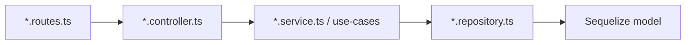

The services module explicitly uses interactors, as shown in `backend/src/modules/services/service.controller.ts`:

```ts
this.listInteractor = new ListServicesInteractor();
this.createInteractor = new CreateServiceInteractor();
this.updateInteractor = new UpdateServiceInteractor();
this.addHostsInteractor = new AddServiceHostsInteractor();
this.removeHostsInteractor = new RemoveServiceHostsInteractor();
this.archiveInteractor = new ArchiveServiceInteractor();
this.restoreInteractor = new RestoreServiceInteractor();
```

---

## Chapter 3: How It Starts - Boot Sequence And Entry Points

Root scripts in `package.json` orchestrate common commands:

```json
"dev:infra": "docker compose -f docker-compose.dev.yml up -d db redis",
"test:backend": "npm test --prefix backend",
"test:frontend": "node --test frontend/tests/sample.test.mjs"
```

Backend development starts with `backend/package.json`:

```json
"dev": "nodemon --watch src --ext ts,js,json --exec node scripts/run-with-env.js development src/main.ts",
"build": "tsc",
"start": "node --max-old-space-size=4096 scripts/run-with-env.js production dist/main.js",
"outbox:worker": "node --max-old-space-size=4096 scripts/run-with-env.js production dist/bin/outbox.worker.js"
```

Frontend development starts with `frontend/package.json`:

```json
"dev": "node scripts/run-next-with-env.js development dev",
"build": "next build",
"start": "node scripts/run-next-with-env.js production start"
```

Backend boot sequence:

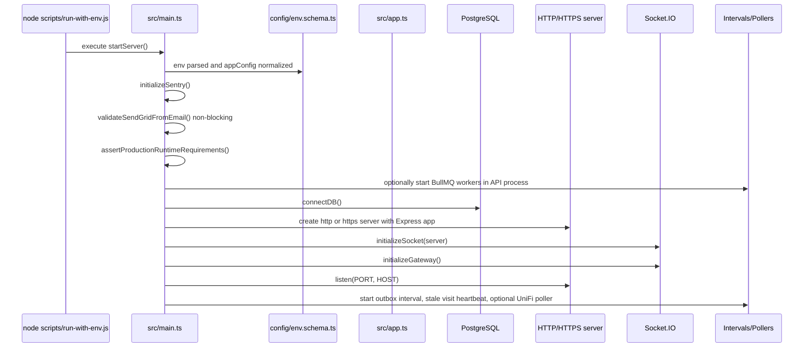

The order is explicit in `backend/src/main.ts`:

```ts
initializeSentry();
assertProductionRuntimeRequirements();
if (appConfig.background.queueWorkersEnabled) {
  const { startWorkers } = require('./infrastructure/queue/workers/index');
  startWorkers().catch((err: any) => logger.error({ err }, 'Worker bootstrap failed'));
}
await connectDB();
const server = appConfig.https.enabled ? https.createServer(...) : http.createServer(app);
initializeSocket(server);
initializeGateway();
server.listen(PORT, HOST, () => { ... });
```

Express middleware order in `backend/src/app.ts` matters:

```ts
app.use(helmet(...));
app.use(cors(...));
app.use(compression());
app.use(express.json({ limit: '10mb', verify: (req: any, _res, buf: Buffer) => { req.rawBody = buf; } }));
app.use(express.urlencoded({ extended: true, limit: '10mb', verify: (req: any, _res, buf: Buffer) => { req.rawBody = buf; } }));
app.use(requestIdMiddleware);
app.use(requestLogger);
app.use(globalLimiter);
app.use(appConfig.api.basePath, apiV1Routes);
app.use(errorHandler);
```

Startup failures:

| Failure | Behavior |
|---|---|
| Env validation fails | `config/index.ts` parses through Zod; invalid env prevents config load and process fails early. |
| Production runtime requirement fails | `assertProductionRuntimeRequirements()` throws; `startServer` catches, logs fatal, exits 1. |
| DB auth/connect fails | `connectDB()` logs fatal and calls `process.exit(1)`. |
| HTTP port bind fails | `server.on('error')` logs fatal, captures Sentry exception, exits 1. |
| Worker bootstrap fails in API process | Error is logged; API continues because `startWorkers().catch(...)` is non-blocking. |
| SendGrid sender validation fails | Warning only; boot continues. |

Graceful shutdown is also in `backend/src/main.ts`: SIGTERM/SIGINT stop intervals and pollers, close HTTP, close workers, close DB, quit Redis, and force kill after 30 seconds.

Standalone outbox worker boot is in `backend/src/bin/outbox.worker.ts`:

```ts
await connectDB();
while (running) {
  try {
    await OutboxProcessor.processPendingEvents();
  } catch (err: any) {
    logger.error({ err }, 'Outbox worker sweep failure');
  }
  await sleep(POLL_INTERVAL_MS);
}
```

Frontend boot is handled by Next.js. `frontend/app/layout.tsx` creates the root layout, and providers under `frontend/providers` attach React Query, theme, auth hydration, and realtime behavior. The key HTTP client is `frontend/shared/lib/api-client.ts`, which sets auth, selected role, CSRF, and refresh retry behavior:

```ts
apiClient.interceptors.request.use((config) => {
  return applyAuthHeaders(config);
});
```

---

## Chapter 4: The Data Layer

Database choice: PostgreSQL, accessed through Sequelize. Redis is not the source of truth; it is a cache, queue substrate, and Socket.IO adapter. Sequelize is configured in `backend/src/infrastructure/database/sequelize.ts`:

```ts
export const sequelize = new Sequelize(env.DB_NAME, env.DB_USER, env.DB_PASSWORD, {
  host: env.DB_HOST,
  port: env.DB_PORT,
  dialect: 'postgres',
  dialectOptions,
  logging: env.NODE_ENV === 'production' ? false : (sql) => logger.debug({ sql }, 'db query'),
  pool: {
    max: env.NODE_ENV === 'production' ? 20 : 5,
    min: env.NODE_ENV === 'production' ? 2 : 1,
    acquire: 30000,
    idle: 10000,
    evict: 1000,
  },
});
```

Core models:

| Model | Table | Purpose | Key Fields |
|---|---|---|---|
| `User` | `users` | Accounts for guests and staff | `email`, `phone`, `office_id`, `password_hash`, status, OTPs, 2FA, password-change flag |
| `Role` | `roles` | RBAC role names | `name` |
| `UserRole` | `user_roles` | User-role join table | `user_id`, `role_id` |
| `AuthSession` | `auth_sessions` | Refresh-token sessions | `token_id`, `refresh_token_hash`, `expires_at`, `revoked_at` |
| `GuestProfile` | `guest_profiles` | Guest metadata | company, government ID, document, OCR text, notification preference, VIP |
| `Office` | `offices` | Physical office/site | name, address, timezone, latitude, longitude |
| `Department` | `departments` | Office department | name, `office_id`, soft delete |
| `Service` | `services` | Bookable service type | name, duration_minutes, department, office, host IDs, soft delete. The `duration_minutes` field controls the actual duration of visits booked for this service. |
| `Host` | `hosts` | Staff who can receive visits | user, department, office, active flag |
| `ServiceHost` | `service_hosts` | Service-host many-to-many | `service_id`, `host_id` |
| `HostProfile` | `host_profiles` | Host HR/profile fields | employee ID, title, bio, avatar |
| `RecurringAvailability` | `recurring_availability` | Host availability rules | recurrence, day/date, start/end, office |
| `TimeSlot` | `time_slots` | Concrete generated slots | host, office, start/end, booked, state |
| `Visit` | `visits` | Central lifecycle object | guest, service, department, office, slot, host, status, schedule, QR, SLA, feedback |
| `VisitAssignment` | `visit_assignments` | Host assignment audit trail | visit, host, assigned_by, metrics, current flag |
| `Approval` | `approvals` | Host/reception decisions | visit, approver, status, reason |
| `Pin` | `pins` | Backup PIN credential | visit, pin code, expiry |
| `AccessCredential` | `access_credentials` | QR/PIN/UniFi credential lifecycle | provider, status, external IDs, validity |
| `Message` | `messages` | Visit chat messages | visit, sender, content |
| `Notification` | `notifications` | In-app notification rows | user, type, title, message, metadata, read flag |
| `OutboxEvent` | `outbox_events` | Transactional side effects | channel, status, event/job payload, attempts, locks |
| `ExternalWebhookEvent` | `external_webhook_events` | Stored third-party webhooks | source, event ID/type, payload, status |
| `AuditLog` | `audit_logs` | Auditable changes | user, request ID, action, entity, metadata |
| `IdempotencyKey` | `idempotency_keys` | POST replay protection | key, stored response |

Relationship diagram:

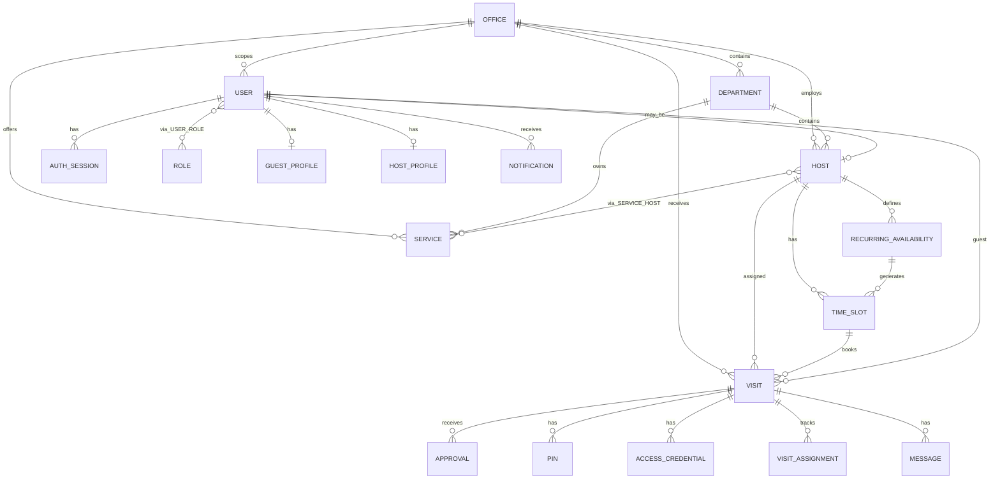

Associations are defined in `backend/src/infrastructure/database/models/index.ts`. The most important snippet:

```ts
Visit.belongsTo(User, { as: "guest", foreignKey: "guest_id" });
Visit.belongsTo(TimeSlot, { foreignKey: "time_slot_id" });
Visit.belongsTo(Service, { as: "service", foreignKey: "service_id" });
Visit.belongsTo(Department, { as: "department", foreignKey: "department_id" });
Visit.belongsTo(Office, { as: "office", foreignKey: "office_id" });
Visit.belongsTo(Host, { as: "assignedHost", foreignKey: "assigned_host_id" });
Visit.hasMany(Approval, { as: "approvals", foreignKey: "visit_id" });
Visit.hasMany(Pin, { as: "pins", foreignKey: "visit_id" });
Visit.hasMany(AccessCredential, { as: "credentials", foreignKey: "visit_id" });
Visit.hasMany(VisitAssignment, { as: "assignments", foreignKey: "visit_id" });
Visit.hasMany(Message, { as: "messages", foreignKey: "visit_id" });
```

The `Visit` model in `backend/src/infrastructure/database/models/Visit.ts` captures how much of the system is visit-centered:

```ts
Visit.init(
  {
    id: { type: DataTypes.BIGINT, primaryKey: true, autoIncrement: true },
    guest_id: { type: DataTypes.BIGINT, allowNull: false },
    service_id: { type: DataTypes.BIGINT, allowNull: true },
    department_id: { type: DataTypes.BIGINT, allowNull: false },
    office_id: { type: DataTypes.BIGINT, allowNull: false },
    time_slot_id: { type: DataTypes.BIGINT, allowNull: true },
    assigned_host_id: { type: DataTypes.BIGINT, allowNull: true },
    status: {
      type: DataTypes.ENUM(...STORED_VISIT_LIFECYCLE_STATUSES),
      defaultValue: 'PENDING',
    },
    scheduled_start: DataTypes.DATE,
    scheduled_end: DataTypes.DATE,
    purpose: { type: DataTypes.TEXT, allowNull: true },
    escalated_to_reception: { type: DataTypes.BOOLEAN, allowNull: false, defaultValue: false },
    qr_code: DataTypes.TEXT,
    sla_deadline_at: { type: DataTypes.DATE, allowNull: true },
    grace_deadline_at: { type: DataTypes.DATE, allowNull: true },
    checked_in_at: { type: DataTypes.DATE, allowNull: true },
    checked_out_at: { type: DataTypes.DATE, allowNull: true },
  },
  { sequelize, tableName: 'visits', timestamps: true, paranoid: true }
);
```

Migration strategy:

| Item | Location | How It Works |
|---|---|---|
| Migration files | `backend/src/core/db/migrations` | Numbered JS migrations run by Sequelize CLI wrapper. |
| Sequelize config | `backend/src/core/db/config/config.js` | Reads `.env` and `.env.<NODE_ENV>` for DB settings. |
| Run local migrations | `cd backend && npm run migrate` | Calls `node scripts/run-sequelize-cli.js development db:migrate`. |
| Run production migrations | `cd backend && npm run migrate:prod` | Uses production env. |
| Undo | `npm run migrate:undo` or `migrate:undo:all` | Sequelize undo commands. |

Migration files include early base tables (`001-create-offices.js` through `014-create-notifications.js`) and later operational upgrades such as `033-create-outbox-events.js`, `039-visit-workflow-enhancements.js`, `045-add-daily-sequence-to-visits.js`, `054-add-performance-indexes.js`, and `20260504195758-add-security-features.js`.

Caching:

`backend/src/infrastructure/cache/cache.service.ts` defines the cache keys and TTLs:

```ts
export const CACHE_TTL = {
  OFFICES: 300,
  DEPARTMENTS: 300,
  SERVICES: 300,
  DASHBOARD: 30,
  HOST_LOAD: 60,
  POLICY: 3600,
} as const;
```

Redis is optional. When `REDIS_URL` is missing or Redis is not ready, cache reads return null and writes no-op:

```ts
static async get<T>(key: string): Promise<T | null> {
  if (!isRedisAvailable() || !redisClient) return null;
  ...
}
```

Validation:

Request validation uses Zod schemas colocated with modules, for example `backend/src/modules/visits/visit.schema.ts`, `backend/src/modules/auth/auth.schema.ts`, and `backend/src/modules/scheduling/availability.schema.ts`. Routes wire validation through `validateRequest`. Example from `backend/src/modules/visits/visit.routes.ts`:

```ts
router.post(
  '/',
  idempotencyMiddleware,
  validateRequest(createVisitSchema),
  enforceOfficeScope(),
  asyncHandler(controller.create)
);
```

---

## Chapter 5: The Core Business Logic

The heart of GMS is the visit lifecycle. A visit starts as a booking request, becomes a scheduled operational commitment, may be approved, rescheduled, reassigned, escalated, checked in, completed, or marked as a no-show. The code keeps those changes safe by combining three ideas: strict role/office scope, database transactions for state changes, and outbox rows for side effects.

The important mental model for a junior developer is this: controllers translate HTTP into method calls, services make decisions, repositories touch tables, and outbox rows carry work to realtime, email, SMS, credential, and SLA processors. If you see a visit status change but no email, do not only inspect the controller. Follow the visit service, then `outbox_events`, then the worker.

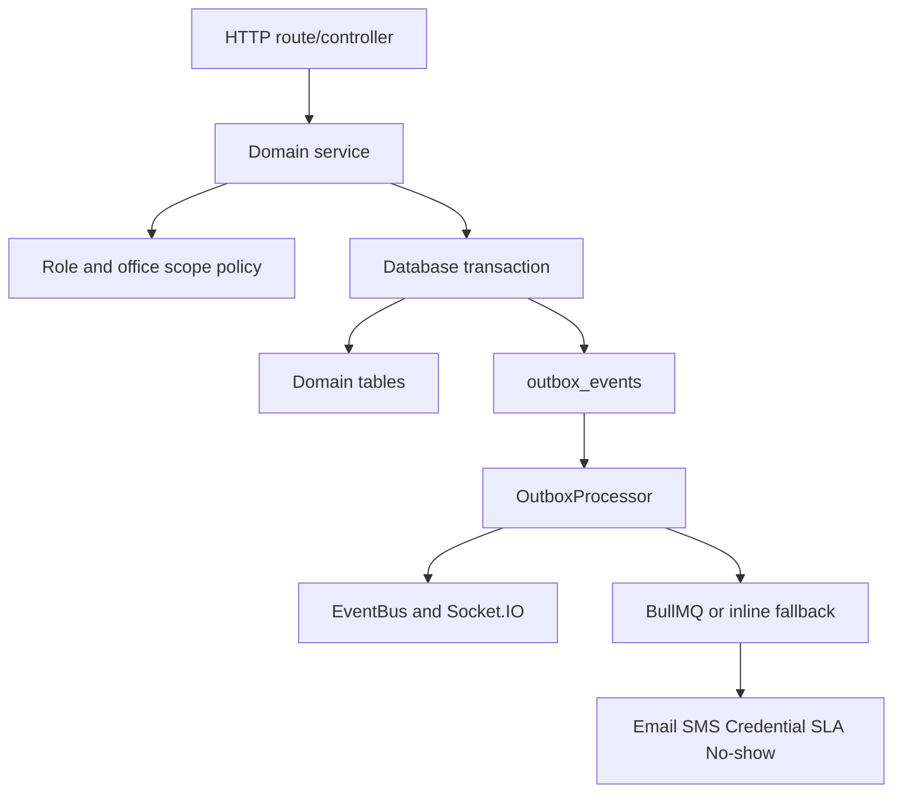

### Authentication

Authentication is not just "check a password." The system creates a durable session, gives the frontend a short-lived access token, and stores a long-lived refresh token in an HTTP-only cookie. The frontend uses the access token for normal API calls. When the token expires, `frontend/shared/lib/api-client.ts` calls `/auth/refresh`, receives a new access token, updates the Zustand auth store, and retries the failed request once.

Registration is intentionally slower than login. A new guest account is created, assigned the `guest` role, and given a registration OTP. The controller returns a "check your email" message instead of logging the user in immediately. Only `/auth/verify` turns that unverified registration into a live session. This matters because many visit flows assume a real `req.user.id`; unverified users should not silently receive usable tokens.

The access token also carries roles and office scope. `X-Selected-Role` is a deliberate role narrowing mechanism. If a user has both `host` and `admin`, the frontend can ask the backend to evaluate one request as `host`. That makes UI role switching possible, but it also means backend code should read `req.userRoles` for the effective role and `req.allRoles` only when it truly needs the full identity.

CSRF protection is tied to cookie-sensitive auth actions. Login and refresh attach a CSRF cookie, and the Axios client sends it back as `X-CSRF-Token`. Do not remove that behavior when adding auth-adjacent endpoints.

Controller proof from `backend/src/modules/auth/auth.controller.ts`:

```ts
public login = async (req: Request, res: Response): Promise<void> => {
  const result: AuthResponseDTO = await this.authService.login(req.body.email, req.body.password, this.getSessionMetadata(req));
  if (result.refreshToken) {
    this.attachRefreshCookie(res, result.refreshToken);
  }
  attachCsrfCookie(res);
  sendSuccess(res, mapPublicAuthResponse(result));
};
```

Registration deliberately stops before session creation:

```ts
public register = async (req: Request, res: Response): Promise<void> => {
  const result = await this.authService.register(req.body, this.getSessionMetadata(req));
  sendSuccess(res, {
    message: 'Registration successful. Please check your email for the verification code.',
    email: req.body.email
  }, 201);
};
```

Role narrowing happens in `backend/src/shared/middleware/auth.middleware.ts`:

```ts
const decodedRoles = normalizeRoles(decoded.roles ?? []);
const selectedRoleHeader = normalizeRoleName(req.headers['x-selected-role']);
if (selectedRoleHeader && !decodedRoles.includes(selectedRoleHeader)) {
  return next(new AppError('Selected role is not available for this session', ErrorCodes.AUTH_FORBIDDEN, 403));
}

const effectiveRoles = selectedRoleHeader ? [selectedRoleHeader] : decodedRoles;
```

### RBAC And Office Scope

GMS has two kinds of staff roles: office-scoped roles and global super roles. `admin`, `reception`, and `host` are office-scoped. `super_admin`, `super_reception`, and `super_host` are global. This naming is easy to misread. In this project, "admin" does not mean "can see the whole company"; it means "can administer the office assigned to this user."

Most scope bugs start when a developer checks only `requireRole(['admin'])` and forgets that the service still needs office filtering. `requireRole` answers "does this person have a suitable role?" It does not answer "is this visit/user/host inside their office?" That second question is answered by domain scope policies such as `VisitScopePolicy`, or helper functions like `requireActorOfficeId`.

For visits, the scope policy is especially important. Super staff see all visits. Admin/reception see only their office. Hosts see visits currently or historically assigned to their host profile. Guests see only their own visits. This is why visit list bugs often look like "the API returned nothing" when the real cause is selected role or office scope.

The role catalog in `backend/src/shared/auth/roles.ts` is the ground truth:

```ts
export const OFFICE_SCOPED_ROLES: AppRole[] = [
  ROLE_NAMES.admin,
  ROLE_NAMES.reception,
  ROLE_NAMES.host,
];

export const SUPER_ROLES: AppRole[] = [
  ROLE_NAMES.super_admin,
  ROLE_NAMES.super_reception,
  ROLE_NAMES.super_host,
];
```

Visit scope filtering from `backend/src/modules/visits/visit.scope.policy.ts`:

```ts
if (isGlobalStaff) {
  // no scope restriction
} else if (isOfficeStaff) {
  filter.office_id = this.requireReceptionOfficeId(actor);
} else if (isHost) {
  const host = await this.hostService.getHostByUserId(actor.id);
  const hostId = Number((host as any).id);
  filter[Op.or] = [
    { assigned_host_id: hostId },
    { id: { [Op.in]: literal(`(SELECT visit_id FROM visit_assignments WHERE host_id = ${hostId})`) } }
  ];
} else {
  filter.guest_id = actor.id;
}
```

### Visit Creation Transaction

A visit creation is the densest workflow in the backend. The route is `POST /api/v1/visits`, the controller is `VisitController.create`, and the real work is `VisitCommandService.createVisit`. Think of the transaction as a room where every related database change must either leave together or not leave at all. If the visit is created but the slot is not booked, two guests could take the same time. If the slot is booked but the visit fails, capacity disappears. The transaction prevents that kind of half-state.

The workflow begins before the transaction with one deliberate optimization: if the payload includes `guest_payload` for a new guest, the random password hash is computed before opening the transaction. Bcrypt is CPU-heavy. Doing it while holding a DB transaction would keep a connection busy for no database reason.

Inside the transaction, the service resolves who the guest is. If `payload.guest_id` exists, it uses that. If `guest_payload.email` belongs to an existing user, it reuses that user and updates profile details such as company, government ID, or document URL. If no user exists, it creates a user, assigns the `guest` role, creates a guest profile, and stores any triage metadata.

Next it loads the guest profile to check VIP status. VIP status changes conflict behavior. Normal guests cannot book locked, blocked, already-booked, past, or overlapping slots. VIP guests can be allowed into a conflict path, but the visit becomes escalated so reception reconciles the overbooking instead of pretending the schedule is clean.

Then the service infers the department. If `department_id` is missing but `service_id` exists, it loads the service and uses its department. If the department still cannot be determined, the request fails. This is not cosmetic: host assignment depends on department and office.

The slot is loaded with a row lock using `findTimeSlotWithLock`. Row locks are how the service prevents two concurrent booking requests from both seeing the same slot as available. The repository locks the `time_slots` row, then separately fetches active visits for that slot because Postgres can behave badly when trying to lock outer-joined rows.

Slot lock code from `backend/src/modules/visits/visit.repository.ts`:

```ts
const slot = await TimeSlot.findByPk(slotId, {
  transaction,
  lock: transaction.LOCK.UPDATE,
});

const visits = await Visit.findAll({
  where: {
    time_slot_id: slotId,
    status: {
      [Op.notIn]: [...NON_OCCUPYING_VISIT_STATUSES],
    },
    deleted_at: null,
  },
  transaction,
});

(slot as any).visits = visits;
return slot;
```

If no explicit host was requested, the host assignment engine tries to load-balance across eligible hosts. It may keep the requested slot, or it may swap to a same-time slot owned by a better host. After that, the service validates the slot and guest overlaps, computes a host SLA deadline, creates a daily reference number, and assembles `visitData`.

The actual write happens in `createVisitAtomic`: create the `visits` row, then mark the slot booked in the same transaction. A database exclusion or unique constraint can still reject the write if another transaction wins the race. The service catches those database errors and turns them into a user-facing slot conflict.

```ts
public async createVisitAtomic(
  visitData: any,
  slotId: number,
  transaction: Transaction,
) {
  const visit = await Visit.create(visitData, { transaction });
  await TimeSlot.update(
    { is_booked: true, slot_state: TIMESLOT_STATE_BOOKED },
    { where: { id: slotId }, transaction },
  );
  return visit;
}
```

After the visit row exists, the service writes a `visit_assignments` audit row if there is an assigned host. Then it attempts to write an audit log, a `VISIT.CREATED` event outbox row, an email job, an SMS job, and an SLA enforcement job. Those side effects are "best effort" in code: many are wrapped in `try/catch`. The important nuance is that successful outbox writes are still inside the transaction, so they commit with the visit.

Creation sequence:

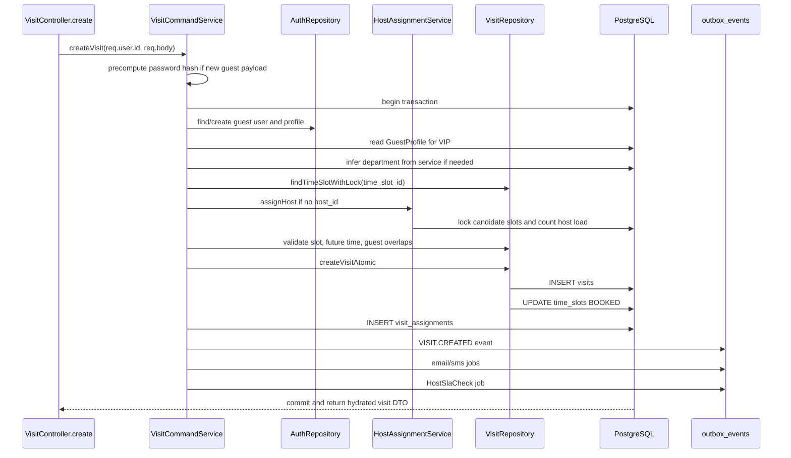

The core creation code lives in `backend/src/modules/visits/visit.command.service.ts`:

```ts
const visitData: any = {
  status: isEscalated ? VISIT_STATUS_ESCALATED : VISIT_STATUS_PENDING,
  guest_id: finalGuestId,
  service_id: serviceId,
  department_id: inferredDepartmentId,
  office_id: officeId,
  time_slot_id: Number((slot as any).id),
  assigned_host_id: assignedHostId,
  scheduled_start: (slot as any).start_time,
  scheduled_end: (slot as any).end_time,
  purpose: payload.purpose ?? null,
  qr_code: randomUUID(),
  reference_number: referenceNumber,
  daily_sequence: dailySeq,
  escalated_to_reception: isEscalated,
  escalated_at: isEscalated ? new Date() : null,
  is_vip: isVip,
  escalation_reason: isEscalated
    ? isVip
      ? "VIP Overbooking - Urgent reconciliation required"
      : "No available host - auto-escalated to reception"
    : null,
  sla_deadline_at: isEscalated ? null : slaDeadline,
};
```

Outbox rows from the same method:

```ts
await publishEvent(
  {
    type: EventTypes.VISIT_CREATED,
    metadata: {
      entity_id: createdVisitId,
      office_id: officeId,
      actor_id: guestId,
      timestamp: new Date(),
    },
  },
  t,
  { type: "Visit", id: createdVisitId },
);

await enqueueJob(
  QUEUE_NAMES.SLA_ENFORCEMENT,
  "HostSlaCheck",
  { visitId: createdVisitId },
  t,
  { type: "Visit", id: createdVisitId },
);
```

### Host Assignment

Host assignment is a small scheduling algorithm, not just "pick the first host." It starts with the service, department, and office requested by the booking. If the service has explicit `host_ids`, those hosts are the candidate pool. If not, candidates are active hosts in the selected department and office. This lets admins make a service route to specific hosts, while general services can use departmental coverage.

The requested slot provides the time window. The algorithm looks for all available slots at that exact start and end time for the eligible hosts, and locks them in a stable `id ASC` order. That stable locking order matters because it reduces deadlock risk when multiple users try to book the same time window.

Once slots are locked, each candidate host gets two scores. The first score is active visit count. Fewer active visits wins. The second score is last assignment time. If two hosts have the same load, the host who has waited longer gets the next visit. A host with no previous assignment gets timestamp `0`, which means they sort early.

The result includes an audit object with candidates and load metrics. Visit creation stores that audit data in `visit_assignments`, so later someone can understand why a host was selected. That is useful when reception asks "why did this guest get routed to this host?"

The algorithm in `backend/src/modules/visits/host-assignment.service.ts`:

```ts
const eligibleHostIds = await this.resolveEligibleHosts(serviceId, departmentId, officeId);
if (eligibleHostIds.length === 0) {
  return this.buildEscalationResult('No eligible hosts found for service/department/office');
}

const availableSlots = await this.repository.findAndLockAvailableSlotsBatch(
  eligibleHostIds,
  slotStartTime,
  slotEndTime,
  transaction,
);
```

Sorting logic:

```ts
candidates.sort((a, b) => {
  if (a.activeVisits !== b.activeVisits) return a.activeVisits - b.activeVisits;
  const aTime = a.lastAssignedAt ? new Date(a.lastAssignedAt).getTime() : 0;
  const bTime = b.lastAssignedAt ? new Date(b.lastAssignedAt).getTime() : 0;
  return aTime - bTime;
});
```

The repository lock query is in `backend/src/modules/visits/host-assignment.repository.ts`:

```ts
return TimeSlot.findAll({
  where: {
    host_id: { [Op.in]: eligibleHostIds },
    start_time: slotStartTime,
    end_time: slotEndTime,
    is_booked: false,
    slot_state: TIMESLOT_STATE_AVAILABLE,
  },
  transaction,
  lock: Transaction.LOCK.UPDATE,
  order: [["id", "ASC"]],
  include: [
    {
      model: Host,
      required: true,
      include: [{ model: User, as: "user", required: true }],
    },
  ],
});
```

### Visit State Machine And Transitions

The state machine protects the system from impossible visit stories. A visit can go from `PENDING` to `APPROVED`, but not from `COMPLETED` to `CHECKED_IN`. It can move from `NO_SHOW` to `RESCHEDULED`, because reception may recover a missed visit, but `COMPLETED` is terminal.

Every status transition goes through `VisitTransitionService.processStatusChange` when using the general status endpoint or approval service. That service checks scope, validates the transition, updates timestamp/deadline metadata, releases slots for terminal statuses, schedules credential expiry for terminal statuses, logs audit, publishes a domain event, and enqueues follow-up jobs for approvals.

Statuses and their plain-English meaning:

| Transition | Trigger | Who Usually Triggers It | Side Effects |
|---|---|---|---|
| `PENDING -> APPROVED` | Host/reception/admin approves | Host, reception, admin | Sets grace deadline, emits `VISIT.APPROVED`, queues credential provisioning, no-show check, reminder. |
| `PENDING -> DECLINED` | Host/reception/admin declines | Host, reception, admin | Emits `VISIT.DECLINED`, approval service notifies guest and queues email/SMS. |
| `PENDING -> CANCELLED` | Staff/admin cancels | Admin/reception/host | Releases slot and queues credential expiry because it is non-occupying. |
| `PENDING -> EXPIRED` | Expiry worker/policy | System | Releases capacity and prevents stale pending requests. |
| `PENDING -> ESCALATED` | Host unavailable, SLA breach, manual escalation | System or staff | Marks reception intervention fields and emits escalation event. |
| `PENDING -> REASSIGNED` | Staff changes host without changing time | Admin/reception/host | Writes assignment history and notifies guest. |
| `PENDING -> REASSIGNED_RESCHEDULED` | Staff changes host and time | Admin/reception/host | Books new slot, releases old slot, waits for guest decision. |
| `APPROVED -> CHECKED_IN` | QR/manual admission | Reception/host/admin | Sets `checked_in_at`, emits check-in event, sends confirmation. |
| `APPROVED -> NO_SHOW` | No-show worker fires after grace/deadline | System | Releases slot, notifies host. |
| `APPROVED -> RESCHEDULED` | Staff changes time | Admin/reception/host | Books replacement slot, sets pending guest decision, notifies guest. |
| `CHECKED_IN -> IN_PROGRESS` | Staff advances active visit | Reception/host/admin | Marks visit as actively underway. |
| `CHECKED_IN -> COMPLETED` | Staff completes directly | Reception/host/admin | Sets `checked_out_at`, releases non-occupying resources, expires credentials. |
| `IN_PROGRESS -> COMPLETED` | Visit ends | Reception/host/admin | Same terminal cleanup as above. |
| `IN_PROGRESS -> ESCALATED` | Active visit needs intervention | Staff | Reception sees escalation. |
| `ESCALATED -> APPROVED` | Reception resolves problem | Reception/admin | Normal approved side effects then resume flow. |
| `ESCALATED -> DECLINED/CANCELLED` | Reception cannot resolve | Reception/admin | Guest is informed; resources released. |
| `ESCALATED -> CHECKED_IN` | Reception admits despite escalation | Reception/admin | Sets checked-in timestamp. |
| `NO_SHOW -> RESCHEDULED` | Recovery booking | Reception/admin | Creates new guest decision path. |
| `EXPIRED -> RESCHEDULED` | Recovery booking | Reception/admin | Lets stale visit get a new time. |
| `DECLINED/CANCELLED -> PENDING` | Correction/reopen | Admin/reception | Reopens a mistaken terminal-like decision. |

State machine code from `backend/src/core/status/VisitStateMachine.ts`:

```ts
public static validateTransition(currentStatus: VisitLifecycleStatus, nextStatus: VisitLifecycleStatus): void {
  if (currentStatus === nextStatus) return;

  const allowed = this.TRANSITIONS[currentStatus] || [];
  if (!allowed.includes(nextStatus)) {
    throw new AppError(
      `Illegal lifecycle transition: Cannot move visit from ${currentStatus} to ${nextStatus}`,
      ErrorCodes.INVALID_OPERATION,
      400
    );
  }
}
```

Approval-specific side effects in `backend/src/modules/visits/visit.transition.service.ts`:

```ts
if (newStatus === VISIT_STATUS_APPROVED) {
  await enqueueJob(
    QUEUE_NAMES.ACCESS_PROVISIONING,
    "ProvisionVisitCredential",
    {
      visitId,
      actorId: normalizedActor.id,
    },
    t,
    { type: "Visit", id: visitId }
  );

  const noShowAt = new Date(scheduledStart.getTime() + 60 * 60 * 1000);
  await enqueueJob(QUEUE_NAMES.NO_SHOW, "NoShowCheck", { visitId }, t, {
    type: "Visit",
    id: visitId,
  }, noShowAt);
}
```

### Approval Flow

Approval begins after a guest creates a non-escalated visit. The visit starts as `PENDING`, has an assigned host, a booked time slot, and an SLA deadline. Creation queues email/SMS to the guest saying the request is pending. It also publishes `VISIT.CREATED`, which can update staff dashboards through the outbox/EventBus/Socket.IO path.

The host or authorized staff member calls `POST /api/v1/approvals/visit/:visitId/decision`. The route requires auth, role `admin`, `host`, or `reception`, a critical action rate limiter, and Zod validation. The controller passes the visit ID, actor identity, and decision payload to `ApprovalService.decideVisit`.

The approval service loads the visit in a transaction and verifies the visit is in an approvable status. If the visit is already approved and the user tries to approve again, the service returns the latest approval and `already_decided: true`. If someone tries to decline an already approved visit, it throws a conflict and tells the caller to reassign, reschedule, or cancel instead. That prevents a destructive contradiction after credentials may already exist.

For a fresh approval, `ApprovalService` delegates the actual visit status change to `VisitService.processStatusChange`. That method queues access provisioning, no-show detection, reminder jobs, audit logs, and events. Then `ApprovalService` inserts the `approvals` row. Notice the approved guest notification is intentionally deferred until credential activation succeeds. In this system, "approved" is not truly guest-ready until a QR/PIN is active.

Approval route in `backend/src/modules/approvals/approval.routes.ts`:

```ts
router.post(
  '/visit/:visitId/decision',
  requireRole(['admin', 'host', 'reception']),
  criticalActionLimiter,
  validateRequest(approvalDecisionSchema),
  asyncHandler(controller.decide)
);
```

Approval service in `backend/src/modules/approvals/approval.service.ts`:

```ts
const updatedVisit = await this.visitService.processStatusChange(
  visitId,
  actor,
  nextStatus,
  transaction,
);
const approval = await this.approvalRepository.create(
  {
    visit_id: visitId,
    approver_id: actor.id,
    status: nextStatus,
    reason: input.reason,
  },
  transaction,
);
```

Full approval flow:

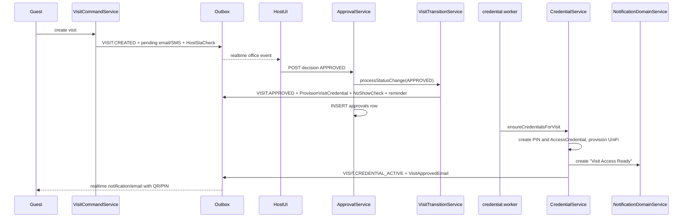

### Reschedule, Reassign, Escalation, And Guest Decision

Reschedule means "same visit, new time slot." The service locks the new slot, verifies it is available and in the future, releases the previous slot, books the new slot, updates the visit to `RESCHEDULED`, and sets `guest_decision_status` to `PENDING_GUEST`. If the new slot belongs to a different host, it also closes the old assignment row and creates a new current assignment. Then it audits, publishes `VISIT.RESCHEDULED`, and queues `VisitRescheduled` email.

Reassign means "same visit, different host." If a new time slot is also supplied or needed, it becomes `REASSIGNED_RESCHEDULED`; otherwise it is `REASSIGNED`. The current assignment is marked non-current, a new assignment is inserted, escalation flags are cleared, and a notification job is queued. If time changed, the guest has to accept or decline because their arrival window changed.

Escalation means "this visit needs reception intervention." It sets status `ESCALATED`, stamps `escalated_at`, records who escalated it, stores a reason, optionally changes the assigned host, publishes `VISIT.ESCALATED`, and queues an SLA escalation job. Escalation is used manually by staff and automatically by SLA/VIP/conflict paths.

Guest decision handles a reschedule/reassignment proposal. If the guest accepts, the visit becomes `PENDING`, the guest decision is marked accepted, and a new QR is generated or marked provisioning-pending in production. If the guest declines, the visit becomes `ESCALATED`, `reception_sla_deadline_at` is set one hour ahead, guest and reception notifications are created, and a reception SLA job is scheduled for that deadline.

Reschedule code from `backend/src/modules/visits/visit.command.service.ts`:

```ts
await this.repository.updateTimeSlot(
  Number((nextSlot as any).id),
  { is_booked: true, slot_state: TIMESLOT_STATE_BOOKED },
  t,
);

const [, updatedRows] = await this.repository.updateVisit(
  visitId,
  {
    time_slot_id: Number((nextSlot as any).id),
    assigned_host_id: Number((nextSlot as any).host_id),
    scheduled_start: (nextSlot as any).start_time,
    scheduled_end: (nextSlot as any).end_time,
    status: VISIT_STATUS_RESCHEDULED,
    guest_decision_status: VISIT_GUEST_DECISION_PENDING,
    guest_decision_at: null,
  },
  t,
);
```

Guest decline code:

```ts
const receptionDeadline = new Date(Date.now() + 60 * 60 * 1000);
const [, updatedRows] = await this.repository.updateVisit(
  visitId,
  {
    guest_decision_status: VISIT_GUEST_DECISION_DECLINED,
    guest_decision_at: new Date(),
    status: VISIT_STATUS_ESCALATED,
    escalated_to_reception: true,
    escalated_at: new Date(),
    escalated_by_id: guestId,
    escalation_reason: "Guest declined proposed reschedule/reassignment",
    reception_sla_deadline_at: receptionDeadline,
  },
  t,
);
```

### Scheduling And Availability

Scheduling has two jobs. First, it returns available slots to booking screens. Second, it lets hosts define recurring availability rules, which materialize into concrete `time_slots`. A booking never reserves a recurring rule directly; it reserves a generated slot.

The public `GET /availability/time_slots` endpoint is intentionally unauthenticated because guests need to see appointment windows while booking. It resolves a service to a department, resolves explicit service host IDs if present, loads active hosts, and returns only slots where `is_booked=false` and `slot_state='AVAILABLE'`.

Host board operations are protected. Hosts can manage their own availability, `super_host` must provide a host ID, and `super_admin` can override in emergencies. Admin and reception can view boards but cannot write host availability rules. That separation is deliberate: staff can coordinate schedules, but hosts own their availability unless a super/admin override is explicit.

Materialization is the tricky part. `AvailabilityService.materializeRuleSlots` walks a horizon of days, checks whether the recurring rule matches each date, combines date and time in the office timezone, splits the window into fixed `DEFAULT_SLOT_DURATION_MINUTES` chunks (60 minutes by default), skips past slots, updates existing unbooked slots, and creates missing ones. **Important**: When a visit is created, the actual `scheduled_end` time is calculated based on the service's `duration_minutes` field, not the timeslot's end time. This allows visits with 30-minute services to end at 30 minutes past the hour even if the timeslot is 60 minutes long, enabling multiple shorter visits within a single availability window.

Time slot listing from `backend/src/modules/scheduling/availability.service.ts`:

```ts
const slotWhere: any = {
  is_booked: false,
  slot_state: "AVAILABLE",
};

if (hostIds.length > 0) {
  slotWhere.host_id = { [Op.in]: hostIds };
} else {
  if (officeId) {
    slotWhere.office_id = { [Op.or]: [officeId, null] };
  }
}
```

Slot materialization:

```ts
for (
  let slotStart = new Date(windowStart.getTime());
  slotStart.getTime() + slotDurationMs <= windowEnd.getTime();
  slotStart = new Date(slotStart.getTime() + slotDurationMs)
) {
  const slotEnd = new Date(slotStart.getTime() + slotDurationMs);
  ...
  await this.repository.createSlot({
    host_id: rule.host_id,
    office_id: rule.office_id ?? null,
    availability_rule_id: rule.id,
    start_time: slotStart,
    end_time: slotEnd,
    is_booked: false,
    slot_state: slotState,
  });
}
```

### Check-In

Check-in is intentionally split between QR validation and manual admission. In the normal path, reception or a host scans a QR. The backend verifies the QR belongs to an approved visit, verifies the staff member is in the right office unless they have a global role, and verifies the scan is inside the allowed time window. Without `manual_override`, the method returns `VALIDATED_ONLY`. That lets UniFi remain the primary physical source of truth.

Manual check-in is the operational escape hatch. If UniFi confirmation is unavailable, admin/reception can mark the visit `CHECKED_IN` from the dashboard. The service writes audit logs including a security policy exception when it cannot find a corresponding UniFi access grant. That is a signal for later reconciliation, not a blocker.

Both successful manual paths call `VisitService.processStatusChange(..., CHECKED_IN)`, queue a `CheckinConfirmation` email, and update the guest profile's last visit timestamp. The state transition service sets `checked_in_at` only if it was not already present.

QR validation path in `backend/src/modules/checkin/checkin.service.ts`:

```ts
const normalizedQrCode = extractVisitQrCode(qrCode);
const visit = await Visit.findOne({ where: { qr_code: normalizedQrCode } });

if (!visit) {
  throw new AppError('Invalid or expired QR code', ErrorCodes.SYSTEM_NOT_FOUND, 404);
}

if (visit.status !== VISIT_STATUS_APPROVED) {
  let statusMessage = `Cannot check in a visit with status '${visit.status}'`;
  ...
  throw new AppError(statusMessage, ErrorCodes.INVALID_INPUT, 400);
}
```

Time window guard:

```ts
const graceMs = VISIT_POLICY.GRACE_PERIOD_MINUTES * 60 * 1000;
const now = Date.now();
const windowStart = new Date(visit.scheduled_start).getTime() - graceMs;
const windowEnd = new Date(visit.scheduled_end).getTime() + graceMs;
if (now < windowStart) {
  const minutesEarly = Math.ceil((windowStart - now) / 60000);
  throw new AppError(
    `Arrival too early: This QR code will become active in ${minutesEarly} minutes.`,
    ErrorCodes.INVALID_INPUT,
    400
  );
}
```

### Credentials

Credential provisioning starts when a visit becomes `APPROVED`. `VisitTransitionService` does not call UniFi directly. It creates an outbox `QUEUE_JOB` for `ACCESS_PROVISIONING`. The credential worker consumes that job and calls `CredentialService.ensureCredentialsForVisit`.

The credential service first locks the visit context and checks that the visit is in a ready-arrival status. It looks for an existing credential. If an active credential already matches the visit's current QR code, it returns that credential and does not reprovision. If the QR changed, for example after regeneration, the mismatch forces reprovisioning.

For a new credential, it computes the validity window from scheduled start/end and VIP status, creates a PIN row, creates a pending `access_credentials` row, and then leaves the transaction. The actual UniFi provisioning happens after the reservation exists. That is important: if UniFi fails, the system can mark the credential failed instead of losing the fact that provisioning was attempted.

On success, the service updates the credential to `ACTIVE`, stores external IDs and door IDs, writes audit, creates a "Visit Access Ready" notification, publishes `VISIT.CREDENTIAL_ACTIVE`, queues `VisitApprovedEmail`, and schedules a reminder job. This is why the guest-facing "approved with QR" message comes after credential activation rather than immediately when the host clicks approve.

Reservation code from `backend/src/modules/credentials/credential.service.ts`:

```ts
const pendingCredential =
  await this.credentialRepository.createCredential(
    {
      visit_id: visitId,
      pin_id: (pin as any).id,
      credential_type: "QR",
      provider: "UNIFI_ACCESS",
      status: CREDENTIAL_STATUS_PENDING,
      valid_from: credentialWindow.validFrom,
      valid_until: credentialWindow.validUntil,
      metadata: {
        qr_code: (visit as any).qr_code,
        ...(qrUrl ? { qr_url: qrUrl } : {}),
        pin_code: provisioningPinCode,
      },
    },
    transaction,
  );
```

Activation side effects:

```ts
await this.notificationService.createNotification(
  (visit as any).guest_id,
  "Visit Access Ready",
  "Your visit has been approved and your access credential is now active.",
  "CREDENTIAL_ACTIVE",
);

await publishEvent(
  {
    type: EventTypes.VISIT_CREDENTIAL_ACTIVE,
    metadata: {
      entity_id: visitId,
      office_id: (visit as any).office_id,
      actor_id: actorId,
      timestamp: new Date(),
    },
  },
  undefined,
  { type: "Visit", id: visitId },
);
```

### Notifications, Outbox, And Realtime

Notifications have three layers. The database layer creates `notifications` rows. The delivery layer queues email/SMS and sends web push when configured. The realtime layer publishes a `NOTIFICATION.CREATED` event so connected browsers can update without refreshing.

The outbox is the reliability hinge. Domain services write outbox rows while changing domain data. `OutboxProcessor` claims rows with `FOR UPDATE SKIP LOCKED`, marks them processing, emits events or dispatches queue jobs, then marks them processed or failed. Failed rows get exponential-ish delay and eventually become `DEAD_LETTER`.

Realtime has two related paths. `socket.ts` bridges all `EventTypes` to `domain_event` with smart fan-out to user, visit, and office rooms. `gateway.ts` also subscribes to selected events and emits an older `event` envelope. The frontend mainly listens to `domain_event`.

Outbox claiming from `backend/src/infrastructure/events/outbox.repository.ts`:

```ts
const rows = await OutboxEvent.findAll({
  where: {
    status: { [Op.in]: ['PENDING', 'FAILED'] },
    available_at: { [Op.lte]: new Date() },
  },
  order: [['created_at', 'ASC']],
  limit,
  transaction,
  lock: transaction.LOCK.UPDATE,
  skipLocked: true,
});
```

Notification creation from `backend/src/modules/notifications/notification.service.ts`:

```ts
const notif = await this.repository.create({ user_id: userId, title, message, type, metadata: metadata ?? null });
await this.dispatchDelivery(userId, title, message);
await this.dispatchPush(userId, title, message, type);

await publishEvent(
  {
    type: EventTypes.NOTIFICATION_CREATED,
    metadata: {
      entity_id: userId,
      actor_id: 0,
      timestamp: new Date(),
      after: { title, message, type, metadata: metadata ?? null, id: notif.id },
    },
  },
  undefined,
  { type: 'Notification', id: notif.id }
);
```

### SLA Enforcement

There are two SLA systems. Host SLA applies to new pending visits. Reception SLA applies after a guest declines a proposed reschedule or reassignment.

Host SLA is set during visit creation. `computeSlaDeadline(new Date())` adds three working hours using the policy window: working days Monday-Friday, 09:00-17:00 UTC by default. If the visit is escalated immediately, no host SLA is set. If the visit is normal pending, a `SLA_ENFORCEMENT` job is queued through the outbox.

When `processSlaEnforcementJob` runs, it loads the visit. If the visit is gone, no problem. If it is no longer `PENDING`, the host already acted, so the job skips. If the deadline is still in the future, it also skips. If the visit is still pending and the deadline has passed, it updates the visit to `ESCALATED`, stamps escalation fields, notifies the host, and queues an SLA escalation job.

Reception SLA starts when the guest declines a reschedule/reassignment. The code sets `reception_sla_deadline_at` to one hour in the future and queues `RECEPTION_SLA_ENFORCEMENT` with `available_at` equal to that deadline. When the worker fires, it only acts if the visit is still `ESCALATED`. If reception already fixed it, it skips. If not, it notifies the guest to rebook and notifies host/reception staff that reception missed the window.

SLA deadline policy from `backend/src/config/visit-policy.config.ts`:

```ts
export const VISIT_POLICY = {
  HOST_SLA_WORKING_HOURS: 3,
  SLA_WORKING_HOUR_START: 9,
  SLA_WORKING_HOUR_END: 17,
  SLA_WORKING_DAYS: [1, 2, 3, 4, 5] as readonly number[],
} as const;
```

Host SLA processor from `backend/src/infrastructure/queue/workers/sla.processor.ts`:

```ts
if (visit.status !== VISIT_STATUS_PENDING) {
  logger.info({ visitId, status: visit.status }, 'SLA processor: Visit already processed, skipping');
  return;
}

if (visit.sla_deadline_at && new Date(visit.sla_deadline_at).getTime() > Date.now()) {
  logger.info({ visitId }, 'SLA processor: SLA deadline not yet reached, skipping');
  return;
}

await Visit.update(
  {
    status: VISIT_STATUS_ESCALATED,
    escalated_to_reception: true,
    escalated_at: new Date(),
    escalation_reason: 'Host did not respond within SLA window (3 working hours)',
  },
  { where: { id: visitId } }
);
```

Reception SLA processor from `backend/src/infrastructure/queue/workers/reception-sla.processor.ts`:

```ts
if (visit.status !== VISIT_STATUS_ESCALATED) {
  logger.info(
    { visitId, status: visit.status },
    'ReceptionSLA: Reception already handled visit - no action needed'
  );
  return;
}
```

### No-Show Processing

No-show processing begins when a visit becomes `APPROVED`. `VisitTransitionService` schedules a `NO_SHOW` job for one hour after `scheduled_start`. Separately, the processor respects `grace_deadline_at` if present; if no grace deadline is present, it falls back to `computeNoShowDeadline(scheduled_end)`, which is currently scheduled end plus eight hours. This means the scheduling time and fallback deadline are not identical, but the processor will skip if its actual grace deadline has not arrived.

When the job runs, it loads the visit. If the visit is missing, it skips. If the visit is no longer `APPROVED`, someone checked in, cancelled, rescheduled, or completed it, so it skips. If the grace deadline is still in the future, it skips. Only an approved visit past the deadline becomes `NO_SHOW`.

After marking no-show, it releases the time slot by setting `is_booked=false` and `slot_state=AVAILABLE`. Then it creates an in-app notification for the host if the visit has an assigned host. Finally, it queues another `NO_SHOW` job named `ProcessNoShow` as an event-like pulse. That naming is a little confusing because it uses the same queue as the check job, but the payload is different.

End-to-end no-show flow:

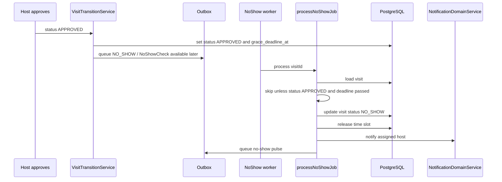

No-show scheduling from `backend/src/modules/visits/visit.transition.service.ts`:

```ts
const noShowAt = new Date(scheduledStart.getTime() + 60 * 60 * 1000);
await enqueueJob(QUEUE_NAMES.NO_SHOW, "NoShowCheck", { visitId }, t, {
  type: "Visit",
  id: visitId,
}, noShowAt);
```

No-show processor from `backend/src/infrastructure/queue/workers/noshow.processor.ts`:

```ts
if (visit.status !== VISIT_STATUS_APPROVED) {
  logger.info({ visitId, status: visit.status }, 'NoShow processor: Visit already processed, skipping');
  return;
}

const graceDeadline = visit.grace_deadline_at
  ? new Date(visit.grace_deadline_at).getTime()
  : computeNoShowDeadline(new Date(visit.scheduled_end)).getTime();

if (Date.now() < graceDeadline) {
  logger.info({ visitId }, 'NoShow processor: Grace period not yet expired, skipping');
  return;
}

await Visit.update({ status: VISIT_STATUS_NO_SHOW }, { where: { id: visitId } });
```

---

## Chapter 6: APIs And Interfaces

All normal backend routes are under `/api/v1` by default. The base path comes from `API_BASE_PATH`, default `/api/v1`.

### HTTP Endpoint Table

| Method | Path | Auth / Role | Description |
|---|---|---|---|
| GET | `/health` | Public | Health check. |
| GET | `/metrics` | Public only if enabled | Prometheus metrics. |
| POST | `/auth/login` | Public, auth rate limited | Login, set refresh and CSRF cookies. |
| POST | `/auth/register` | Public, auth rate limited | Register guest, send OTP. |
| POST | `/auth/verify` | Public, auth rate limited | Verify registration OTP and establish session. |
| POST | `/auth/refresh` | Refresh cookie/body | Rotate refresh token and return access token. |
| POST | `/auth/logout` | CSRF required | Revoke refresh session and clear cookies. |
| GET | `/auth/me` | Refresh session | Validate current session. |
| POST | `/auth/forgot-password` | Public | Send reset code if account exists. |
| POST | `/auth/reset-password` | Public | Reset password with OTP. |
| POST | `/auth/verify-2fa` | Public | Complete 2FA login. |
| POST | `/auth/change-password` | Auth + CSRF | Change own password. |
| POST | `/auth/toggle-2fa` | Auth + CSRF | Enable/disable 2FA. |
| POST | `/auth/verify-password` | Auth | Verify current password. |
| GET | `/users/profile` | Auth | Current user profile. |
| GET | `/users` | Admin | List users. |
| POST | `/users` | Admin | Create user. |
| GET | `/users/:id` | Admin/reception | Get user. |
| PATCH | `/users/:id` | Admin | Update user. |
| DELETE | `/users/:id` | Admin | Soft delete user. |
| POST | `/users/:id/restore` | Admin | Restore user. |
| POST | `/users/:id/roles` | Admin | Set roles. |
| POST | `/users/bulk-import` | Admin | Bulk import users. |
| GET | `/visits` | Auth | List scoped visits. |
| POST | `/visits` | Auth + optional idempotency | Create visit. |
| GET | `/visits/:id` | Auth, scoped | Get visit. |
| GET | `/visits/:id/qr.png` | Auth, scoped | Download QR PNG. |
| PATCH | `/visits/:id/status` | Admin/host/reception | State transition. |
| POST | `/visits/:id/reschedule` | Admin/host/reception | Reschedule visit. |
| POST | `/visits/:id/reassign` | Admin/host/reception | Reassign host. |
| POST | `/visits/:id/escalate` | Admin/host/reception | Escalate to reception. |
| POST | `/visits/:id/guest-decision` | Auth guest owner | Accept/decline reschedule or reassignment. |
| POST | `/visits/:id/extend` | Admin/host/reception | Extend in-building visit. |
| POST | `/visits/:id/feedback` | Guest | Submit rating/comment. |
| DELETE | `/visits/:id` | Admin/super_admin | Archive visit. |
| POST | `/visits/:id/restore` | Admin/super_admin | Restore archived visit. |
| POST | `/visits/:id/regenerate-qr` | Admin/reception/super roles | Regenerate access credential. |
| GET | `/visits/:id/messages` | Auth + chat access | List visit messages. |
| POST | `/visits/:id/messages` | Auth + chat access | Send visit message. |
| GET | `/offices` | Optional auth | Public office listing for booking. |
| GET | `/offices/:id` | Optional auth | Public office detail. |
| POST | `/offices` | Super admin | Create office. |
| PATCH | `/offices/:id` | Super admin | Update office. |
| DELETE | `/offices/:id` | Super admin | Archive office. |
| POST | `/offices/:id/restore` | Super admin | Restore office. |
| POST | `/checkin` | Admin/reception/host | QR/manual-override check-in. |
| POST | `/checkin/manual` | Admin/reception | Manual check-in by visit ID. |
| GET | `/departments` | Auth | List departments. |
| GET | `/departments/:id` | Auth | Get department. |
| POST | `/departments` | Admin | Create department. |
| PATCH | `/departments/:id` | Admin | Update department. |
| DELETE | `/departments/:id` | Admin | Soft delete department. |
| POST | `/departments/:id/restore` | Admin | Restore department. |
| GET | `/services` | Optional auth | List services for booking/admin. |
| POST | `/services` | Admin | Create service. |
| PATCH | `/services/:id` | Admin | Update service. |
| DELETE | `/services/:id` | Admin | Archive service. |
| POST | `/services/:id/restore` | Admin | Restore service. |
| POST | `/services/:id/hosts` | Admin | Add host associations. |
| DELETE | `/services/:id/hosts/:hostId` | Admin | Remove one host association. |
| GET | `/hosts` | Staff roles | List hosts. |
| GET | `/hosts/:id` | Staff roles | Get host. |
| PUT | `/hosts/:id/services` | Admin/super_admin | Replace host services. |
| POST | `/hosts/:id/services/add` | Admin/super_admin | Add host services. |
| DELETE | `/hosts/:id/services` | Admin/super_admin | Remove service list. |
| DELETE | `/hosts/:id/services/:serviceId` | Admin/super_admin | Remove one service. |
| GET | `/notifications/vapid-public-key` | Public route in code | Get Web Push key. |
| GET | `/notifications` | Auth | List current-user notifications. |
| POST | `/notifications/push-subscription` | Auth | Save push subscription. |
| DELETE | `/notifications/push-subscription` | Auth | Delete push subscription. |
| POST | `/notifications/read-all` | Auth | Mark all read. |
| POST | `/notifications/:id/read` | Auth | Mark one read. |
| GET | `/availability/time_slots` | Public | List available slots. |
| GET | `/availability/host-board` | Admin/host/reception | Host availability board. |
| POST | `/availability/rules` | Host/super_admin | Create recurring rule. |
| PATCH | `/availability/rules/:id` | Host/super_admin | Update rule. |
| DELETE | `/availability/rules/:id` | Host/super_admin | Delete rule. |
| DELETE | `/availability/time_slots/:id` | Host/super_admin | Delete generated slot. |
| GET | `/approvals/visit/:visitId` | Admin/host/reception | List approvals. |
| POST | `/approvals/visit/:visitId/decision` | Admin/host/reception | Approve/decline. |
| GET | `/credentials/visit/:visitId` | Auth + scoped | List credentials. |
| POST | `/credentials/visit/:visitId/revoke` | Admin/host/reception | Revoke credentials. |
| POST | `/credentials/visit/:visitId/fallback-qr` | Admin/host/reception | Issue fallback QR. |
| GET | `/guests/me` | Auth | Get own guest profile. |
| PATCH | `/guests/me` | Auth | Update own guest profile. |
| GET | `/guests` | Admin/reception/host | List guests. |
| GET | `/guests/:id` | Admin/reception/host | Managed guest profile. |
| PATCH | `/guests/:id` | Admin/reception | Update managed profile. |
| POST | `/guests/bulk-import` | Admin | Bulk import guests. |
| GET | `/operations/dashboard` | Staff ops roles | Dashboard. |
| GET | `/operations/reports` | Staff ops roles | Reports. |
| GET | `/operations/integrations` | Admin/reception/super | Integration health. |
| GET | `/operations/integration-health` | Admin/reception/super | Alias of `/operations/integrations` (same payload; the admin frontend calls this path). |
| POST | `/operations/integrations/outbox/:id/retry` | Admin | Retry outbox event. Surfaced in `/admin/system-health`. |
| POST | `/operations/integrations/unifi-webhooks/:id/replay` | Admin | Replay UniFi webhook. Surfaced in `/admin/system-health`. |
| POST | `/operations/seed` | Admin | Start seed workflow. |
| GET | `/operations/seed/:runId` | Admin | Seed status. |
| GET | `/operations/bulk-template` | Admin | Template data. |
| POST | `/operations/bulk-import-org` | Admin | Import org rows. |
| GET | `/operations/audit-logs` | Admin | Paginated, filterable (entity/action/userId/date range) read of the `audit_logs` table. Surfaced in `/admin/audit-log`. Read-only; the write path is unchanged (`logAudit()` in `shared/services/audit.service.ts`). |
| POST | `/integrations/unifi/webhooks/access` | Webhook schema/secret | Ingest UniFi webhook. |
| POST | `/ocr/scan` | Public in route code | OCR identity document. |
| POST | `/simulation/start` | See route | Start simulation engine. |
| POST | `/simulation/stop` | See route | Stop simulation engine. |
| GET | `/simulation/status` | See route | Simulation status. |

Note: the OpenAPI spec says `/ocr/scan` has auth, but `backend/src/modules/ocr/ocr.routes.ts` does not call `requireAuth` — re-verified 2026-09-06, the route still has only `authLimiter` and body validation, and `api/v1/index.ts` applies no blanket auth. Trust the code: OCR scan is public. (The spec lives in `backend/src/api/swagger.ts`; the `openapi.json` this note used to cite was deleted in July 2026.)

### Request/Response Shape

Responses use helper wrappers. Successful controllers call `sendSuccess`, `ok`, `created`, or `sendPaginated`. Errors use a structured envelope from `errorHandler`.

Validation errors are transformed in `backend/src/shared/middleware/errorHandler.ts`:

```ts
if (err instanceof ZodError) {
  const details = err.issues.map((e: any) => ({
    path: e.path.join("."),
    message: humanizeZodIssue(e),
  }));
  return sendError(res, details[0].message, 400, "INVALID_INPUT", details);
}
```

Example login:

```http
POST /api/v1/auth/login
Content-Type: application/json

{
  "email": "guest@example.com",
  "password": "Passw0rd!"
}
```

Example visit creation:

```http
POST /api/v1/visits
Authorization: Bearer <access-token>
Idempotency-Key: booking-guest-123-slot-456
Content-Type: application/json

{
  "office_id": 1,
  "department_id": 2,
  "service_id": 4,
  "time_slot_id": 456,
  "purpose": "Contract meeting"
}
```

### WebSocket Interface

Socket auth uses the access token. From `backend/src/infrastructure/websocket/socket.ts`:

```ts
io.use((socket, next) => {
  const token = socket.handshake.auth.token || socket.handshake.headers.authorization?.split(' ')[1];
  if (!token) return next(new Error('Authentication entirely missing'));
  ...
});
```

Rooms:

| Room | Meaning |
|---|---|
| `user_<id>` | Personal notifications/events for one user. |
| `office_<id>` | Reception/admin coordination for an office. |
| `visit_<id>` | Visit chat and active visit context. |

Client-side bridge in `frontend/providers/RealtimeBridge.tsx` listens to `domain_event` and invalidates React Query caches:

```ts
socket.on('domain_event', (payload: DomainEventPayload) => {
  const { type, metadata } = payload;
  window.dispatchEvent(new CustomEvent(SOCKET_EVENT_EVENT, { detail: payload }));

  if (type.startsWith('VISIT.')) {
    queryClient.invalidateQueries({ queryKey: ['visits'] });
    queryClient.invalidateQueries({ queryKey: ['operations-dashboard'] });
  }
});
```

### Background Jobs

Queue names from `backend/src/infrastructure/queue/queue.ts`:

```ts
export const QUEUE_NAMES = {
  EMAIL_NOTIFICATION: 'EMAILS',
  SMS_NOTIFICATION: 'SMS',
  VISIT_REMINDER: 'REMINDERS',
  EXPIRATIONS: 'EXPIRATIONS',
  ACCESS_PROVISIONING: 'ACCESS_PROVISIONING',
  DEAD_LETTER: 'DEAD_LETTER',
  SLA_ENFORCEMENT: 'SLA_ENFORCEMENT',
  SLA_ESCALATION: 'SLA_ESCALATION',
  RECEPTION_SLA_ENFORCEMENT: 'RECEPTION_SLA_ENFORCEMENT',
  NO_SHOW: 'NO_SHOW',
  IDENTITY_VERIFICATION: 'IDENTITY_VERIFICATION',
} as const;
```

Workers are loaded by `backend/src/infrastructure/queue/workers/index.ts`. It tries email, SMS, expiry, reminder, credential, identity workers, then explicitly creates SLA, no-show, and reception SLA workers. `identity.worker` is referenced but no source file exists in the current tree, so the registry logs a module-load error for that missing worker. This is a real discrepancy/tech-debt item.

---

## Chapter 7: The Outside World - Integrations And Config

### Environment Variables

Backend env vars are defined by Zod in `backend/src/config/env.schema.ts`.

| Variable | Required | Default | Purpose |
|---|---:|---|---|
| `NODE_ENV` | No | `development` | `development`, `production`, or `test`. |
| `PORT` | No | `7200` | API listen port. |
| `HOST` | No | prod `0.0.0.0`, dev `127.0.0.1` | API bind host. |
| `CLIENT_URL` | No | `http://localhost:7201` | Frontend URL and CORS origin. |
| `CORS_ALLOWED_ORIGINS` | No | empty | Extra comma-separated origins. |
| `API_BASE_PATH` | No | `/api/v1` | API route prefix. |
| `SOCKET_PATH` | No | `/socket.io` | Socket.IO path. |
| `HTTPS_ENABLED` | No | `false` | Enables HTTPS server. |
| `HTTPS_PFX_PATH` | No | none | PFX certificate path. |
| `HTTPS_PFX_PASSPHRASE` | No | none | PFX passphrase. |
| `ENABLE_API_DOCS` | No | `true` | Swagger UI in production only if true. |
| `ENABLE_PUBLIC_METRICS_ROUTE` | No | `true` | Public `/metrics` in production only if true. |
| `DB_HOST` | Yes | none | PostgreSQL host. |
| `DB_PORT` | No | `5432` | PostgreSQL port. |
| `DB_USER` | Yes | none | PostgreSQL user. |
| `DB_PASSWORD` | Yes | none | PostgreSQL password. |
| `DB_NAME` | Yes | none | PostgreSQL database name. |
| `DB_SSL_ENABLED` | No | `false` | PostgreSQL SSL. |
| `DB_SSL_REJECT_UNAUTHORIZED` | No | `true` | SSL certificate verification. |
| `REDIS_URL` | No | none | Enables Redis, BullMQ, cache, socket adapter. |
| `JWT_SECRET` | Yes | none | Access-token signing secret; production min 32 chars. |
| `JWT_REFRESH_SECRET` | Prod required | optional dev | Refresh-token secret; production min 32 chars. |
| `JWT_EXPIRES_IN` | No | `3h` | Access token lifetime. |
| `JWT_REFRESH_EXPIRES_IN` | No | `7d` | Refresh token lifetime/cookie max age. |
| `SMTP_HOST` | No | none | SMTP host. |
| `SMTP_PORT` | No | `587` | SMTP port. |
| `SMTP_USER` | No | none | SMTP username. |
| `SMTP_PASS` | No | none | SMTP password. |
| `FROM_EMAIL` | No | none | Default sender. |
| `SENDGRID_API_KEY` | No | none | SendGrid API key. |
| `SENDGRID_FROM_EMAIL` | No | `FROM_EMAIL` | SendGrid sender. |
| `SENDGRID_TIMEOUT_MS` | No | `10000` | SendGrid timeout. |
| `SMS_PROVIDER` | No | none | SMS provider selector. |
| `SMS_BASE_URL` | No | none | Generic SMS URL. |
| `SMS_API_KEY` | No | none | Generic SMS key. |
| `SMS_FROM` | No | none | SMS sender. |
| `SMS_TIMEOUT_MS` | No | `10000` | SMS timeout. |
| `AFRICAS_TALKING_USERNAME` | No | none | Africa's Talking username. |
| `AFRICAS_TALKING_API_KEY` | No | none | Africa's Talking key. |
| `AFRICAS_TALKING_BASE_URL` | No | `https://api.africastalking.com` | Africa's Talking base URL. |
| `UNIFI_ACCESS_BASE_URL` | No | none | UniFi Access API base. |
| `UNIFI_ACCESS_API_KEY` | No | none | UniFi Access key. |
| `UNIFI_ACCESS_TIMEOUT_MS` | No | `10000` | UniFi timeout. |
| `UNIFI_ACCESS_MAX_RETRIES` | No | `3` | UniFi retry count. |
| `UNIFI_ACCESS_TLS_REJECT_UNAUTHORIZED` | No | `true` | UniFi TLS verification. |
| `UNIFI_ACCESS_QR_MODE` | No | `auto` | QR mode: `auto`, `system`, `unifi`. |
| `UNIFI_ACCESS_DOOR_MAP` | No | none | Door mapping config. |
| `UNIFI_ACCESS_RESOURCE_MAP` | No | none | Resource mapping config. |
| `UNIFI_ACCESS_WEBHOOK_SECRET` | No | none | Legacy/HMAC webhook secret. |
| `UNIFI_ACCESS_POLL_INTERVAL_MS` | No | `15000` | UniFi poll interval. |
| `SENTRY_DSN` | No | none | Sentry error reporting. |
| `SENTRY_TRACES_SAMPLE_RATE` | No | `0.2` | Sentry traces sample rate. |
| `METRICS_ENABLED` | No | `true` | Prometheus metrics collection. |
| `RATE_LIMIT_GLOBAL_MAX` | No | `1000` | Global per-window max. |
| `RATE_LIMIT_AUTH_MAX` | No | `10` | Auth per-window max. |
| `RATE_LIMIT_CRITICAL_MAX` | No | `60` | Critical action max. |
| `OUTBOX_POLL_INTERVAL_MS` | No | `5000` | Outbox sweep cadence. |
| `ENABLE_QUEUE_WORKERS` | No | `true` | Start workers inside API process. |
| `ENABLE_OUTBOX_POLLING` | No | `true` | API process outbox interval. |
| `ENABLE_UNIFI_ACCESS_POLLING` | No | `false` | API process UniFi polling. |
| `VAPID_PUBLIC_KEY` | No | none | Web Push public key. |
| `VAPID_PRIVATE_KEY` | No | none | Web Push private key. |
| `VAPID_SUBJECT` | No | `mailto:systems@examplecorp.com` | Web Push subject. |

Frontend public env variables are represented by `.env.example`, scripts, and Docker build args:

| Variable | Purpose |
|---|---|
| `NEXT_PUBLIC_API_BASE_URL` | Browser-visible API base, normally `http://localhost:7200/api/v1`. |
| `NEXT_PUBLIC_SOCKET_URL` | Browser-visible Socket.IO origin. |
| `NEXT_PUBLIC_APP_URL` | Public app URL. |
| `NEXT_PUBLIC_BASE_PATH` | Optional Next.js base path. |
| `NEXT_PUBLIC_SOCKET_PATH` | Optional socket path override. |

Secrets are managed through `.env` files locally and `.env.production`/container env in deployment. The repository currently has tracked `.env.example` and also local `.env*` files in the working tree. Treat `.env.development` and `.env.production` as sensitive operational files.

### Integrations

| Integration | Code | Behavior If Down |
|---|---|---|
| PostgreSQL | `sequelize.ts` | Startup fails; API exits. |
| Redis | `redis.client.ts`, queue/cache/socket files | Cache no-ops, queue dispatcher falls back inline, socket adapter falls back in-memory if adapter setup fails. |
| SendGrid | `shared/services/sendgrid.service.ts`, email workers | Sender validation warns; email jobs can fail/retry. |
| SMTP/Nodemailer | `infrastructure/email/email.service.ts` | Email delivery failure logged/queued depending path. |
| SMS / Africa's Talking | `infrastructure/sms/sms.service.ts` | SMS jobs can fail and be retried/dead-lettered. |
| UniFi Access | `infrastructure/unifi`, `modules/unifi-webhooks` | Provisioning can fall back to internal QR depending config and service logic. |
| Sentry | `shared/services/sentry.service.ts` | Optional; capture no-ops if DSN absent. |
| Web Push | `infrastructure/push/web-push.service.ts`, notifications module | VAPID route exposes key; push disabled if keys absent. |
| Tesseract OCR | `shared/services/ocr.service.ts` | OCR scan throws and returns structured error. |

UniFi webhook ingestion route:

```ts
router.post('/webhooks/access', validateRequest(unifiWebhookSchema), asyncHandler(controller.handle));
```

The controller accepts legacy secret or signature headers:

```ts
const legacySecret = req.headers['x-unifi-webhook-secret'] as string | undefined;
const signatureHeader =
  (req.headers['signature'] || req.headers['x-unifi-signature'] || req.headers['x-signature'] || req.headers['x-hub-signature']) as
    | string
    | undefined;
```

Rate limits are configured from env and applied globally and on auth/critical routes. Critical routes include logout, refresh, check-in, approvals, and credential revocation.

---

## Chapter 8: Infrastructure And Deployment

### Local Development From Zero

Assuming Node 22, Docker, and npm are installed:

```bash
npm run setup:env
npm run dev:infra
cd backend
npm install
npm run migrate
npm run seed:core
npm run dev
```

In another terminal:

```bash
cd frontend
npm install
npm run dev
```

Typical local URLs:

| Service | URL |
|---|---|
| Frontend | `http://localhost:7201` |
| API | `http://127.0.0.1:7200` or env `PORT` |
| API health | `/api/v1/health` |
| Swagger | `/api-docs` if enabled |
| Dev Postgres | host `localhost:5434`, DB `gmsdev` |
| Dev Redis | `localhost:6382` |

### Docker Compose

`docker-compose.dev.yml` only starts Postgres and Redis for local development:

```yaml
services:
  db:
    image: postgres:15-alpine
    ports:
      - "5434:5432"
  redis:
    image: redis:7-alpine
    ports:
      - "6382:6379"
```

`docker-compose.yml` starts the full stack:

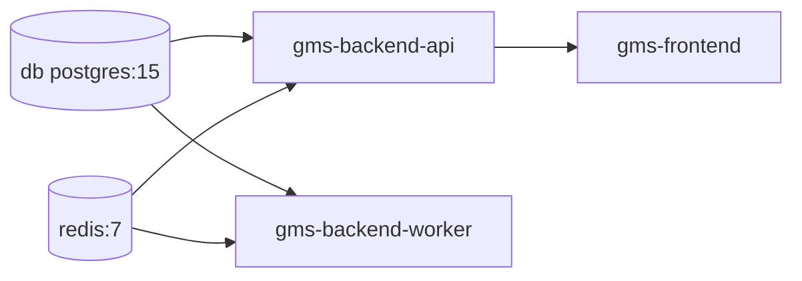

Important production-like compose behavior:

| Container | Purpose | Important Detail |
|---|---|---|
| `db` | PostgreSQL 15 | Host port defaults to `5433` to avoid local conflict. |
| `redis` | Redis 7 | Host port defaults to `6380`; append-only enabled. |
| `backend` | API | `ENABLE_QUEUE_WORKERS=false`, `ENABLE_OUTBOX_POLLING=false` so side effects are isolated to worker. |
| `worker` | Outbox + BullMQ workers | Runs `npm run outbox:worker`, enables workers and polling. |
| `frontend` | Next standalone server | Built with public API/socket URLs as build args. |

Backend Dockerfile compiles TypeScript, installs prod deps, copies migrations/seeders/scripts, and runs:

```dockerfile
CMD ["node", "scripts/run-with-env.js", "production", "dist/main.js"]
```

Frontend Dockerfile builds Next standalone output and runs:

```dockerfile
CMD ["node", "server.js"]
```

### CI/CD

CI lives in `.github/workflows/phase2-validation.yml`:

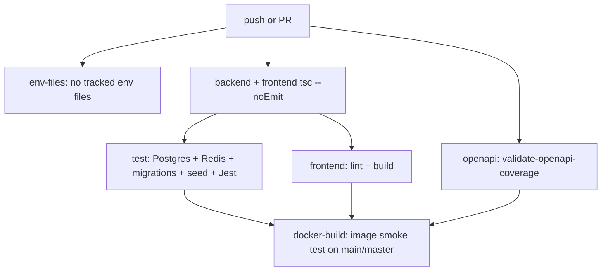

CI steps (repaired 2026-09-06 — the old `frontend-tests` job ran a deleted
placeholder test and failed on every push for two months; see
README.md for that history):

| Job | What It Does |
|---|---|
| `env-files` | Fails if a real (non-example) env file is accidentally tracked. |
| `typecheck` | Installs backend/frontend deps and runs TypeScript no-emit checks. |
| `test` | Starts Postgres/Redis services, builds backend, migrates, seeds, runs Jest. |
| `frontend` | Runs `npm run lint` + a real production build (replaced the old placeholder test). |
| `openapi` | Runs `backend/scripts/validate-openapi-coverage.js`. |
| `docker-build` | On main/master, builds backend and frontend Docker images (`needs: [test, openapi, frontend]`). |

### Manual Deployment

Backend includes PM2 commands:

```json
"pm2:start": "pm2 start deploy/ecosystem.config.js",
"deploy:manual": "npm run build && pm2 reload gms-api || pm2 start deploy/ecosystem.config.js --only gms-api"
```

Deployment is documented in `DEPLOY-WINDOWS-MANUAL.md` (plain Node on Windows) and
`PRODUCTION_GUIDE.md` (PM2 + nginx). Trust the actual scripts and `backend/deploy/ecosystem.config.js`
when they differ from prose.

Monitoring/logging:

| Concern | Implementation |
|---|---|
| Request logging | `requestLogger` middleware plus Pino/Winston logger under `backend/src/core/logger/logger.ts`. |
| Metrics | Prometheus `prom-client`, exposed by `/metrics` when enabled. |
| Errors | `errorHandler` plus optional Sentry capture. |
| Worker health | Compose worker health checks `pgrep -f outbox.worker`; worker logs via logger. |
| Integration health | `/operations/integrations` (alias `/operations/integration-health`); viewable/actionable in the admin frontend at `/admin/system-health` (queue depths, failed outbox/webhook recovery). |
| Audit trail | `audit_logs` table, written by `logAudit()`; read-only via `GET /operations/audit-logs`, viewable in the admin frontend at `/admin/audit-log`. |

---

## Chapter 9: Testing

Testing is mostly backend Jest plus a small frontend Node built-in test. There are also load-test scripts and Postman collections.

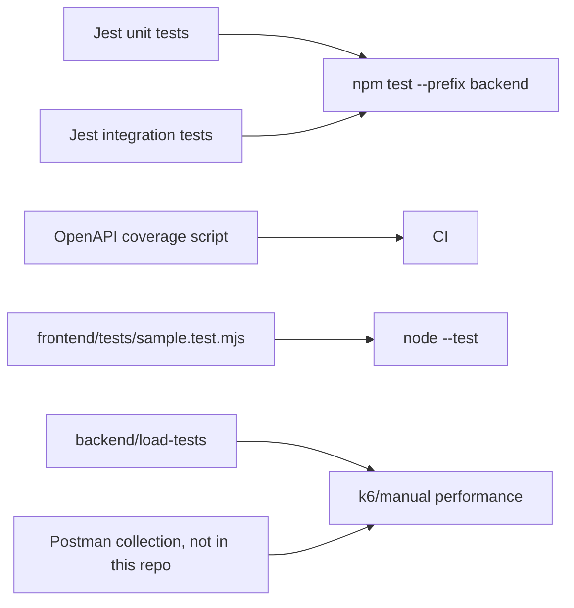

Backend tests live in:

| Location | Coverage |
|---|---|
| `backend/src/tests/*.test.ts` | Auth, visits, outbox, queues, messages, notifications, SLA, no-show, runtime requirements, CORS, idempotency, integrations. |
| `backend/src/tests/unit/VisitStateMachine.test.ts` | State machine. |
| `backend/src/tests/integration/DBConnection.test.ts` | DB connectivity. |
| `backend/src/modules/*/*.test.ts` | Module-local tests, e.g. auth and visit lifecycle notifications. |
| `backend/src/tests/helpers` | Test auth, DB, request, time helpers. |

Jest config is `backend/jest.config.js`:

```json
{
  "preset": "ts-jest",
  "testEnvironment": "node",
  "setupFilesAfterEnv": ["<rootDir>/src/tests/setup.ts"]
}
```

`backend/src/tests/setup.ts` closes workers and queues after tests:

```ts
const { closeWorkers } = await import('../infrastructure/queue/workers/registry.js');
teardownTasks.push(closeWorkers());
const { closeQueues } = await import('../infrastructure/queue/queue.js');
teardownTasks.push(closeQueues());
```

How to run:

| Need | Command |
|---|---|
| All repo tests | `npm test` |
| Backend tests | `npm run test:backend` or `cd backend && npm test` |
| Backend watch | `cd backend && npm run test:watch` |
| Backend coverage | `cd backend && npm run test:coverage` |
| Frontend sanity | `npm run test:frontend` |
| OpenAPI coverage | `cd backend && npm run test:openapi-coverage` |
| CI-style suite | `npm run test:ci` |

Example test, from `backend/src/tests/visit-management-routes.test.ts`, validates request schema before service logic:

```ts
const spy = jest.spyOn(VisitService.prototype, 'rescheduleVisit');
await request(app)
  .post('/api/v1/visits/55/reschedule')
  .set('Authorization', `Bearer ${token}`)
  .send({});
expect(spy).not.toHaveBeenCalled();
```

What is not fully tested:

| Gap | Risk |
|---|---|
| Frontend UI behavior | The frontend has only a minimal Node sanity test, not Playwright/e2e coverage in current scripts. |
| Real third-party integrations | SendGrid, UniFi, SMS are mostly exercised through mocks or service-level tests, not live contracts. |
| Full browser realtime flows | Socket.IO is tested in pieces, but end-to-end UI invalidation is not broad. |

---

## Chapter 10: Developer Guide - Day-To-Day Work

When you add a feature to this codebase, start by asking what kind of feature it is. Does it change durable data? Does it change a visit lifecycle? Does it send a notification? Does it need frontend UI only, or does it need a backend endpoint? This project rewards that thinking because each responsibility already has a home.

Imagine we are pairing. Before touching files, we open the nearest existing feature that looks like ours. For a visit mutation, read `backend/src/modules/visits/visit.routes.ts`, `visit.controller.ts`, `visit.service.ts`, `visit.command.service.ts`, and the relevant frontend feature API in `frontend/features/visits/api.ts`. We are not looking to copy blindly; we are learning the house style. Routes validate and authorize. Controllers unpack HTTP. Services make decisions. Repositories touch raw persistence. Frontend feature APIs hide endpoint paths from components.

If the feature changes the database shape, we begin with a migration because the database is the contract all other layers rely on. Then we update the Sequelize model so TypeScript and runtime fields match. If the feature only changes behavior using existing columns, we skip migration and keep the change narrower. After that we add backend validation, service logic, tests, OpenAPI docs if the endpoint is public, frontend API wrappers, hooks, and finally UI.

Do not start from the UI unless the feature is purely cosmetic. UI-first backend guesses are how this codebase gets route drift, missing scope checks, and shape mismatches. Start with the domain event: "what should be true after this action succeeds?" Then build outward.

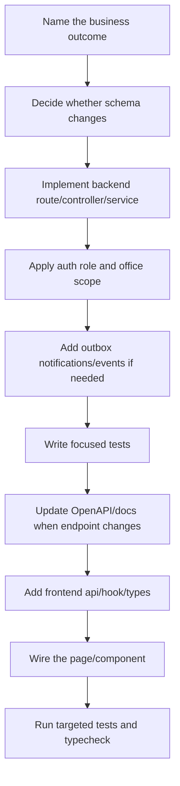

### Adding A Backend Endpoint, Slowly

Suppose the action is a visit mutation. We first decide who is allowed to perform it. If it is staff-only, the route should use `requireAuth` and `requireRole`. If it is office-bound, the service must also call a scope policy. A route-level role check alone is not enough. `admin` can mean "admin for one office," so the service still needs to reject visits outside that office.

Next, define the request shape with Zod. The project validates `params`, `query`, and `body` through `validateRequest`, usually by merging `idParamSchema` with a module schema. The controller should not parse a complicated object or make business decisions. It should turn `req.params.id`, `req.user`, `req.userRoles`, and `req.body` into a service call.

Then add the service method. If multiple rows must change together, use `withTransaction`. If the method sends email, SMS, realtime, or worker jobs, prefer outbox helpers from `backend/src/infrastructure/events/outbox.service.ts`. If a side effect is allowed to happen after commit, do not call an external provider directly inside a transaction.

This route pattern from `backend/src/modules/visits/visit.routes.ts` is the model:

```ts
router.post(
  '/:id/reschedule',
  requireRole(['admin', 'host', 'reception']),
  validateRequest(idParamSchema.merge(rescheduleVisitSchema)),
  asyncHandler(controller.reschedule)
);
```

And this controller pattern keeps HTTP thin:

```ts
public reschedule = async (req: Request, res: Response): Promise<void> => {
  const visit = await this.service.rescheduleVisit(
    Number(req.params.id),
    {
      id: req.user!.id,
      roles: req.userRoles,
      office_id: req.user?.office_id,
    },
    req.body
  );
  sendSuccess(res, visit);
};
```

### Adding A Data Model Or Migration

If the feature needs a column, create a migration under `backend/src/core/db/migrations`. Use the existing naming style: numbered or timestamped JS files. The model in `backend/src/infrastructure/database/models` must be updated too. If there is a relationship, wire it in `models/index.ts`.

Run `cd backend && npm run migrate` after adding the migration. If tests need the field, CI will run migrations against the test database. Do not patch production manually and then "document it later"; this repo expects migrations to describe schema history.

Use migrations for constraints as well as columns. For visit features, constraints matter because concurrency is real: two users may try to book or mutate the same operational resource at the same time. If the database can enforce the invariant, make it enforce the invariant.

### Adding Config

Backend config starts in `backend/src/config/env.schema.ts`. Add the variable there with a type, default, and production validation if needed. Then expose it through `backend/src/config/app.config.ts` so the rest of the app reads normalized config rather than raw `process.env`. Add the variable to `.env.example`.

Frontend config that must be visible in the browser must be prefixed with `NEXT_PUBLIC_`. Add it to `frontend/.env.example`, update Docker build args if it is needed at build time, and use the existing runtime helpers where possible.

### Worked Example: Let Hosts Mark A Visit As VIP

This example is intentionally concrete. The current database already has `visits.is_vip`, and visit creation copies VIP status from the guest profile. We will add an endpoint that lets the current assigned host mark an existing visit VIP. Because the column already exists, we do not need a migration. If the column did not exist, the first step would be a migration and model update.

Business rule: a host can mark only their currently assigned visit as VIP. Admin/reception may also use the action for office-bound operational support. The action should audit the change and publish a visit event so dashboards refresh. It should not directly send email unless product asks for guest notification.

Step 1: Add validation schema in `backend/src/modules/visits/visit.schema.ts`.

```ts
export const markVipSchema = z.object({
  body: z.object({
    is_vip: z.boolean(),
    reason: z.string().max(500).optional(),
  }),
});
```

Why here? Every visits request schema already lives in `visit.schema.ts`, and routes import from that file. Keeping it there lets tests and route readers find the contract quickly.

Step 2: Add a route in `backend/src/modules/visits/visit.routes.ts`.

```ts
import {
  createVisitSchema,
  escalateVisitSchema,
  guestDecisionSchema,
  listVisitsQuerySchema,
  markVipSchema,
  reassignVisitSchema,
  rescheduleVisitSchema,
  updateVisitStatusSchema,
  extendVisitSchema,
  submitFeedbackSchema,
} from './visit.schema';

router.post(
  '/:id/vip',
  requireRole(['admin', 'host', 'reception']),
  validateRequest(idParamSchema.merge(markVipSchema)),
  asyncHandler(controller.markVip)
);
```

Why `POST`? This is an action endpoint, like `/:id/reschedule` and `/:id/escalate`. A `PATCH /:id` generic update would be more REST-ish, but this codebase uses action routes for operational visit mutations.

Step 3: Add a controller method in `backend/src/modules/visits/visit.controller.ts`.

```ts
public markVip = async (req: Request, res: Response): Promise<void> => {
  const visit = await this.service.markVip(
    Number(req.params.id),
    {
      id: req.user!.id,
      roles: req.userRoles,
      office_id: req.user?.office_id,
    },
    {
      is_vip: Boolean(req.body.is_vip),
      reason: req.body.reason,
    }
  );
  sendSuccess(res, visit);
};
```

The controller does not check whether the actor is the assigned host. That belongs in the service/scope policy, because the same rule may be needed by future non-HTTP callers.

Step 4: Add a facade method in `backend/src/modules/visits/visit.service.ts`.

```ts
public async markVip(
  visitId: number,
  actor: VisitActor,
  payload: { is_vip: boolean; reason?: string },
) {
  return this.commandService.markVip(visitId, actor, payload);
}
```

This keeps `VisitService` as the single class controllers use, while implementation stays in `VisitCommandService`.

Step 5: Implement command logic in `backend/src/modules/visits/visit.command.service.ts`.

```ts
public async markVip(
  visitId: number,
  actor: VisitActor,
  payload: { is_vip: boolean; reason?: string },
) {
  return withTransaction(async (t) => {
    const visit = await this.repository.findById(visitId, t);
    if (!visit) {
      throw new AppError("Visit not found", ErrorCodes.SYSTEM_NOT_FOUND, 404);
    }

    await this.scopePolicy.assertActorCanManageVisit(visit as any, actor);
    assertNotTerminalVisitStatus((visit as any).status);

    const [, updatedRows] = await this.repository.updateVisit(
      visitId,
      { is_vip: payload.is_vip },
      t,
    );

    await logAudit(
      actor.id,
      payload.is_vip ? "VISIT_MARKED_VIP" : "VISIT_UNMARKED_VIP",
      "Visit",
      visitId,
      { is_vip: (visit as any).is_vip },
      { is_vip: payload.is_vip, reason: payload.reason ?? null },
      t,
    );

    await publishEvent(
      {
        type: EventTypes.VISIT_ESCALATED,
        metadata: {
          entity_id: visitId,
          actor_id: actor.id,
          office_id: Number((visit as any).office_id),
          timestamp: new Date(),
          after: { is_vip: payload.is_vip, reason: payload.reason ?? null },
        },
      },
      t,
      { type: "Visit", id: visitId },
    );

    const hydrated = await this.repository.findById(visitId, t);
    return mapVisitToDTO(hydrated ?? updatedRows[0]);
  });
}
```

One design choice above deserves attention: the example reuses `VISIT_ESCALATED` as the event because the current `EventTypes` enum has no `VISIT_UPDATED` or `VISIT_VIP_CHANGED`. In a production-quality implementation, a cleaner version would add `VISIT_VIP_CHANGED` to `backend/src/infrastructure/events/eventTypes.ts`, teach the socket gateway/frontends about it, and update OpenAPI. Reusing an existing event is fast but semantically muddy. A senior reviewer may ask you to add the explicit event.

Step 6: Make sure the DTO already exposes `is_vip`. If not, update `backend/src/modules/visits/visit.dto.ts`. The frontend cannot render the new state if the DTO strips it out.

Example DTO addition:

```ts
is_vip: Boolean((visit as any).is_vip),
```

Step 7: Add a frontend API method in `frontend/features/visits/api.ts`.

```ts
async markVip(id: number, payload: { is_vip: boolean; reason?: string }) {
  const response = await apiClient.post(`/visits/${id}/vip`, payload);
  return response.data.data;
}
```

Step 8: Add a React Query hook in `frontend/features/visits/hooks.ts`.

```ts
export const useMarkVisitVip = () => {
  const queryClient = useQueryClient();
  return useMutation({
    mutationFn: ({ id, ...payload }: { id: number; is_vip: boolean; reason?: string }) =>
      visitsApi.markVip(id, payload),
    onSuccess: () => {
      queryClient.invalidateQueries({ queryKey: ['visits'] });
      queryClient.invalidateQueries({ queryKey: ['operations-dashboard'] });
    },
  });
};
```

Step 9: Wire a host UI button in a host visit page such as `frontend/app/host/visits/page.tsx`. Find the existing action buttons for reschedule/reassign/escalate and add the VIP action near those operational controls. Use the existing button style and disable it while the mutation is pending.

Example UI fragment:

```tsx
const markVipMutation = useMarkVisitVip();

<button
  onClick={() =>
    markVipMutation.mutate({
      id: visit.id,
      is_vip: !visit.is_vip,
      reason: visit.is_vip ? 'Host removed VIP flag' : 'Host marked priority guest',
    })
  }
  disabled={markVipMutation.isPending}
  className="ui-btn ui-btn-secondary py-2 text-xs"
>
  {visit.is_vip ? 'Remove VIP' : 'Mark VIP'}
</button>
```

Step 10: Add tests. At minimum, add a backend route/service test proving the assigned host can mark their visit VIP, a different host cannot, office-scoped admin cannot mark another office's visit, and terminal visits are rejected. The test should assert both the response and database field.

Test shape:

```ts
it('allows the assigned host to mark a visit VIP', async () => {
  const response = await request(app)
    .post(`/api/v1/visits/${visit.id}/vip`)
    .set('Authorization', `Bearer ${hostToken}`)
    .send({ is_vip: true, reason: 'Priority guest' })
    .expect(200);

  expect(response.body.data.is_vip).toBe(true);
});
```

Step 11: Update the OpenAPI spec and this document. `npm run test:openapi-coverage` gates CI, so a new route fails the build unless it is documented. The spec is `backend/src/api/swagger.ts` — a hand-written object, not generated from JSDoc (the unused `swagger-jsdoc` dependency that implied otherwise was removed on 2026-09-06). Add `POST /visits/{id}/vip` to its `paths`. (Until 2026-09-06 this step named `openapi.yaml`/`.json`, which were deleted in July 2026 — which is why that gate had been failing on every push for two months.)

### Debugging Workflows

When the API will not boot, start with environment validation and database connection. If `connectDB()` fails, the server exits. If production runtime requirements fail, the server exits before listening. Use `backend/src/config/env.schema.ts`, `backend/src/config/runtime-requirements.ts`, and the startup logs.

When a request returns 403, ask three questions in this order: is the JWT valid, does `X-Selected-Role` narrow the user into a role that lacks permission, and is the target entity outside the user's office? Many "but this user is admin" bugs are actually selected-role or office-scope bugs.

When a notification or email does not arrive, inspect `outbox_events` first. If there is no row, the domain service never queued the side effect. If the row is `FAILED`, inspect `error_message`. If it is `PROCESSED`, inspect the worker logs or provider configuration. For realtime, also verify the frontend is listening to `domain_event`.

When a visit cannot be created because a slot is locked, check both `time_slots` and active visits on the slot. The service checks `is_booked`, `slot_state`, active `visits`, guest overlaps, and database constraints. Do not assume one flag explains every conflict.

### Code Style And Working Agreements

Use TypeScript and the existing module boundaries. Use `asyncHandler` for controllers. Use Zod for request validation. Use `sendSuccess`, `ok`, `created`, and `sendPaginated` rather than inventing response shapes. Use `AppError` for expected operational failures.

Use `withTransaction` whenever multiple domain writes must succeed together. Use outbox helpers for side effects. Be suspicious of direct email, SMS, Socket.IO, or UniFi calls inside a database transaction unless the code has a very specific reason.

Frontend code should go through feature APIs and hooks. Components should not sprinkle raw `apiClient.post(...)` calls everywhere. Shared UI belongs under `frontend/shared`, while route pages belong under `frontend/app`.

Git workflow is documented in `CONTRIBUTING.md`. CI runs on PRs and pushes; main/master builds Docker images. The current repository has unrelated uncommitted changes to root package files and generated document artifacts, so check `git status --short` before staging.

---

## Chapter 11: Gotchas, Sharp Edges And Tech Debt

This chapter is the part you read when something feels irrational. Most sharp edges in this repo come from one of four things: role scope, outbox timing, generated-vs-source files, or docs drifting from code. The bugs are usually not mysterious once you know which layer owns the truth.

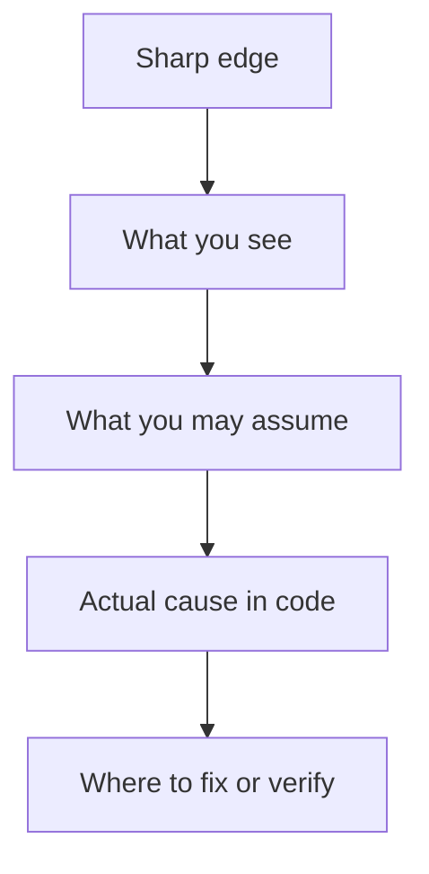

### Gotcha 1: `admin` Is Office-Scoped, Not Global

Symptom: an admin user logs in, opens the visits or users page, and cannot see data from another office. A junior developer may think the backend filter is broken because the route allows `admin`. The route is not the full permission story. `admin` means "office admin." Only `super_admin` has global office scope.

This happens because role authorization and office authorization are separate. `requireRole(['admin'])` allows the request into the route, but service-level code still applies `office_id` constraints. For visits, `VisitScopePolicy.buildScopedFilter` adds `filter.office_id = this.requireReceptionOfficeId(actor)` for office staff.

Avoid it by always asking: "Does this role allow the action, and does this actor own the target office?" When writing tests, create both same-office and different-office data. When debugging, inspect the JWT `office_id`, the selected role header, and the final scope filter.

Code reference in `backend/src/modules/visits/visit.scope.policy.ts`:

```ts
if (isGlobalStaff) {
  // no scope restriction
} else if (isOfficeStaff) {
  filter.office_id = this.requireReceptionOfficeId(actor);
}
```

Debugging story: You will see a 403 saying "Visit is outside your office scope." You may think `requireRole` rejected the user. It did not. The user passed `requireRole`; the service rejected the target visit. Confirm by logging or inspecting `req.userRoles`, `req.user.office_id`, and the visit's `office_id`. The fix is either to use a same-office test fixture, assign the user's office correctly, or use a super role if the product requirement is truly global access.

### Gotcha 2: `X-Selected-Role` Can Remove Permissions You Thought You Had

Symptom: a multi-role user can perform an action in one browser state but gets 403 after switching role in the UI. The access token still contains all roles, so it looks like the backend randomly forgot a permission.

The cause is role narrowing in `auth.middleware.ts`. If the request includes `X-Selected-Role: host`, the backend sets `req.userRoles` to only `['host']` even if the token also contains `admin`. That is a feature, not a bug. It lets the UI behave as a specific portal role.

Avoid it by using `req.userRoles` for effective permission and `req.allRoles` only when the code truly needs to know the full account identity. On the frontend, make sure the selected role matches the workspace. Do not send `X-Selected-Role` casually from scripts or API clients.

Code reference in `backend/src/shared/middleware/auth.middleware.ts`:

```ts
const effectiveRoles = selectedRoleHeader ? [selectedRoleHeader] : decodedRoles;
req.userRoles = effectiveRoles;
req.allRoles = decodedRoles;
```

Debugging story: You will see "Insufficient role. Required: admin" even though the database shows the user has `admin`. You will think role assignment failed. It is actually the selected role header. Reproduce with curl without `X-Selected-Role`; if it succeeds, fix the frontend role selection or the test header.

### Gotcha 3: Outbox Rows Are The Real Side-Effect Boundary

Symptom: a visit is approved, but the guest does not receive email immediately, or the UI updates later than the API response. New developers often search inside the approval controller for email code and find nothing.

The cause is the transactional outbox pattern. The API writes domain changes and outbox rows. Workers later claim those rows and perform side effects. Approval also defers guest "access ready" notification until credentials activate, so host approval is not the final guest notification point.

Avoid it by checking `outbox_events` before assuming a worker bug. If there is no row, the service failed to enqueue the side effect. If the row is `FAILED`, inspect `error_message`. If it is `PENDING`, the processor may not be running. If it is `PROCESSED`, inspect the provider-specific worker.

Code reference in `backend/src/infrastructure/events/outbox.processor.ts`:

```ts
if (row.channel === 'EVENT_BUS') {
  EventBus.emitEvent(row.payload as any);
} else if (row.channel === 'QUEUE_JOB') {
  await dispatchQueueJob(String(row.queue_name), String(row.job_name), row.payload);
}
```

Debugging story: You approve a visit and expect an approval email. You will think `ApprovalService` forgot email. Actually, `ApprovalService` delegates to `VisitTransitionService`, which queues `ACCESS_PROVISIONING`. The guest approval email is sent after `CredentialService.ensureCredentialsForVisit` marks a credential active and queues `VisitApprovedEmail`. Trace `approvals -> visit transition -> outbox ACCESS_PROVISIONING -> credential.worker -> CredentialService -> outbox EMAILS`.

### Gotcha 4: Redis Is Optional, So Queue Behavior Changes By Environment

Symptom: in local development, an operation sends an email or processes a job during the HTTP request, but in Docker/production it happens later in the worker. Or a request feels slow when Redis is not configured.

The cause is `dispatchQueueJob`. If Redis queues are available, it enqueues. If Redis is unavailable or disabled, it imports worker logic and executes inline as a last-resort safety net. That keeps business workflows from silently dropping work, but it changes timing.

Avoid it by testing worker-sensitive behavior with Redis enabled when timing matters. In unit tests, be aware that inline fallback may execute worker code unless it is mocked. For production, keep Redis healthy because inline fallback inside the API process is resilience, not the desired steady state.

Code reference in `backend/src/infrastructure/queue/dispatchers.ts`:

```ts
logger.warn(
  { queueName, jobName, production: appConfig.isProduction },
  'Redis queue unavailable or disabled, executing worker logic inline'
);
```

### Gotcha 5: `identity.worker` Was Referenced But Missing — RESOLVED

**Update (2026-07-12):** this gotcha is resolved, not by building the missing worker, but by removing the dead reference. `identity.worker` is no longer listed in `workerModules`, and the matching `enqueueJob(QUEUE_NAMES.IDENTITY_VERIFICATION, ...)` call in `auth.service.ts#register` is commented out with an explanatory note — both were producing rows/log noise for a feature with no consumer. If identity verification is ever actually built, re-add both together (worker module, dispatcher case, registry entry, enqueue call) rather than one at a time.

Original symptom (for history): worker startup logged an error about a module failing to load. The system still appeared healthy, because the registry caught the error and continued starting other workers — the cause was `backend/src/infrastructure/queue/workers/index.ts` listing `identity.worker` in `workerModules` with no corresponding file, while `auth.service.ts` still queued `IDENTITY_VERIFICATION` jobs nothing ever consumed.

### Gotcha 6: OCR Route Is Public In Code Despite OpenAPI Saying Auth — INTENTIONAL, NOW RATE-LIMITED

**Update (2026-07-12):** re-investigated as part of a security audit and confirmed this is **not fixable by adding `requireAuth`** — `/ocr/scan` is called from the public guest self-registration page (`frontend/app/page.tsx`, `RegisterPage`) *before* any account or token exists, so requiring auth would break guest sign-up. The OpenAPI spec was wrong, not the code. Since the route is unauthenticated and processes PII (identity document images) plus a watchlist check, it's now behind `authLimiter` (a strict per-IP rate limit) to bound abuse — see `backend/src/modules/ocr/ocr.routes.ts`. The executable contract is: **public + rate-limited**, not "public by drift, should be authenticated."

Original symptom (for history): security review or API client docs said `/ocr/scan` requires authentication, but a direct request reached the route without `Authorization` — drift between the OpenAPI spec (marked authenticated) and the actual route (which never called `requireAuth`, only validated the request body).

### Gotcha 7: WebSocket Has Two Event Shapes

Symptom: a backend event appears in logs, but the frontend does not update. Or a component listens for `event` while another listens for `domain_event`.

The cause is duplicated realtime bridging. `socket.ts` bridges all `EventTypes` to `domain_event` and handles smart user/visit/office room fan-out. `gateway.ts` subscribes to selected events and emits an older `event` envelope. The frontend `RealtimeBridge` primarily handles `domain_event`.

Avoid it by using `domain_event` for new client behavior unless there is a specific old consumer needing `event`. When adding a new event type, verify that `EventTypes` includes it, the outbox publishes it, Socket.IO receives it, and the frontend invalidates the correct query keys.

Frontend listener in `frontend/providers/RealtimeBridge.tsx`:

```ts
socket.on('domain_event', (payload: DomainEventPayload) => {
  const { type, metadata } = payload;
  window.dispatchEvent(new CustomEvent(SOCKET_EVENT_EVENT, { detail: payload }));

  if (type.startsWith('VISIT.')) {
    queryClient.invalidateQueries({ queryKey: ['visits'] });
    queryClient.invalidateQueries({ queryKey: ['operations-dashboard'] });
  }
});
```

### Gotcha 8: RealtimeBridge Cleanup Did Not Remove The Actual Window Listeners — RESOLVED

**Update (2026-07-12):** fixed. All three listener functions (join office, join visit, leave visit) were hoisted into the effect's own scope in `frontend/providers/RealtimeBridge.tsx`, so cleanup now removes the exact same function reference it added — confirmed all three are correctly removed on unmount. This was also worse than the single-listener description below suggested: because the effect's dependencies included the access token (which rotates on every background refresh), this teardown-and-leak cycle fired roughly every 15 minutes on any long-lived reception/host session, not just on navigation — that recurrence is gone too.

Original symptom (for history): after auth/session changes or rapid navigation, local browser events could be handled more than once. The cause was cleanup calling `window.removeEventListener(JOIN_OFFICE_EVENT, () => {})` — a **new** function literal, not the original `onJoinOffice` handler — and only the join-office listener even attempted removal; the join-visit and leave-visit listeners had no removal call at all.

### Gotcha 9: Generated Output Exists Beside Source

Symptom: you fix a bug in `backend/dist/...` or `frontend/.next/...`, run the app later, and the bug comes back. Or grep finds two copies of the same function and you edit the wrong one.

The cause is generated build output checked into or present in the working tree. The authoritative source is under `backend/src` and `frontend/app`, `frontend/features`, `frontend/shared`, etc. `dist` and `.next` are artifacts.

Avoid it by excluding generated directories from code searches when you want source. Use `rg --glob '!backend/dist/**' --glob '!frontend/.next/**'`. Never hand-edit generated output. Rebuild instead.

### Gotcha 10: Soft Deletes Are Not Uniform

Symptom: a deleted user, service, department, or visit disappears from normal queries but can still be restored. Another table's deleted-looking record is actually gone forever. This inconsistency confuses new developers.

The cause is Sequelize `paranoid` is enabled only on some models: users, departments, services, visits. Many supporting tables such as `pins`, `time_slots`, `approvals`, and `messages` are not paranoid.

Avoid it by checking the model options before writing delete or restore logic. If the model has `paranoid: true`, use `destroy` and `restore` carefully. If it does not, a delete is a real delete unless the service implements another archive flag.

Example from `backend/src/infrastructure/database/models/Visit.ts`:

```ts
{
  sequelize,
  tableName: 'visits',
  timestamps: true,
  createdAt: 'created_at',
  updatedAt: 'updated_at',
  paranoid: true,
  deletedAt: 'deleted_at',
}
```

### Gotcha 11: `services.host_ids` And `service_hosts` Both Exist

Symptom: a host/service relationship appears correct in one API but wrong in another. You update the join table and the `host_ids` array stays stale, or vice versa.

The cause is the current schema has both a join table `service_hosts` and an array column `services.host_ids`. Associations use `ServiceHost`, while parts of host assignment and availability still read `service.host_ids`. `UserService.syncHostServiceAssignments` tries to keep both in sync, but manual edits or partial code paths can drift.

Avoid it by using existing service/host assignment methods instead of updating either table directly. If you add new relationship code, update both representations or, better, plan a cleanup migration that picks one source of truth.

Sync code in `backend/src/modules/users/user.service.ts`:

```ts
const rows = await ServiceHost.findAll({
  where: { service_id: serviceId },
  attributes: ["host_id"],
  transaction,
});
const hostIds = rows.map((row: any) => Number(row.host_id));
await Service.update(
  { host_ids: hostIds },
  { where: { id: serviceId }, transaction },
);
```

### Gotcha 12: No-Show Timing Has Two Policies In Play

Symptom: a no-show job runs but logs "Grace period not yet expired" and does nothing. You may think the worker is broken because the job was scheduled for that time.

The cause is `VisitTransitionService` schedules `NoShowCheck` one hour after `scheduled_start`, while `processNoShowJob` checks `visit.grace_deadline_at` if set, otherwise falls back to `scheduled_end + NO_SHOW_WINDOW_HOURS`. These can differ. The processor is the final authority and will skip early jobs.

Avoid it by reading both the scheduler and processor before changing no-show behavior. If product wants a precise no-show rule, align `noShowAt`, `grace_deadline_at`, and `VISIT_POLICY.NO_SHOW_WINDOW_HOURS`.

### Gotcha 13: Best-Effort Catches Can Hide Missing Outbox Rows

Symptom: a visit is created successfully, but an expected audit/event/job row is absent. There is no failed transaction and no user-facing error.

The cause is `VisitCommandService.createVisit` wraps several audit/outbox calls in `try/catch` and swallows failures. The visit can commit even when a side effect row failed to be created. This is a tradeoff: booking success is prioritized over non-critical side effects, but it makes observability harder.

Avoid it by checking logs around creation time and considering whether a side effect should remain best-effort. For critical side effects, do not swallow the error. For non-critical ones, make sure logs are good enough to find the failure.

### Security And Performance Reminders

Cross-office leakage is the most important security risk. Always apply scope policies for office-bound entities. Do not rely on route roles alone.

PII is everywhere: guest documents, OCR text, government IDs, phone numbers, emails, and QR/PIN data. Avoid logging full payloads. When writing audits, store the operational facts needed for traceability, not entire sensitive documents.

Credential and visit mutations can involve physical access. Do not treat QR regeneration, fallback QR, check-in, and manual override as ordinary CRUD. Each should leave an audit trail.

Performance-wise, avoid CPU-heavy work inside transactions. The existing visit creation code precomputes bcrypt before the transaction for this reason. Keep database transactions short, especially around locked slots.

---

## Chapter 12: Frontend Architecture

The frontend is a Next.js App Router application, but the most useful way to understand it is not "pages and components." Think of it as four cooperating layers:

1. Route layouts decide which workspace the user is in.
2. Zustand stores hold browser-local session and UI state.
3. React Query owns server data fetched from the backend.
4. `RealtimeBridge` listens for backend domain events and tells React Query what is stale.

That split is the frontend equivalent of the backend's controller/service/outbox pattern. Route layouts keep users in the right portal. Zustand answers "who am I, what role am I acting as, and what local UI mode is open?" React Query answers "what does the server currently say?" Socket events do not directly mutate large frontend objects; they invalidate query keys so the next render refetches the authoritative backend state.

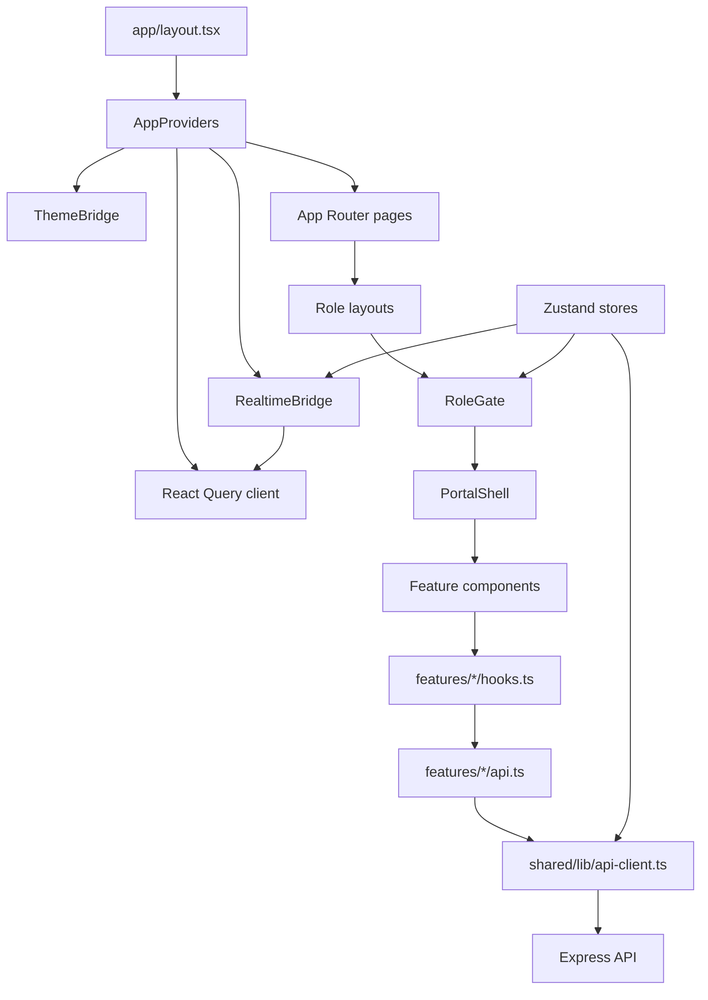

### App Router Layout Hierarchy

The root layout is the only layout every route shares. It sets metadata, global CSS, the Inter font, and wraps the application in `AppProviders` and `MotionLayout`. This is why providers such as React Query, the theme bridge, the realtime socket bridge, confirm dialogs, toast notifications, and push-notification prompting are available everywhere.

Code from `frontend/app/layout.tsx`:

```tsx
export default function RootLayout({ children }: { children: React.ReactNode }) {
  return (
    <html lang="en" suppressHydrationWarning>
      <body className={`${inter.className} antialiased selection:bg-brand-primary/30 bg-surface-background text-content-base`}>
        <AppProviders>
          <MotionLayout>
            {children}
          </MotionLayout>
        </AppProviders>
      </body>
    </html>
  );
}
```

`AppProviders` is a client component because its responsibilities are browser-only: Zustand hydration, local storage, sockets, push notifications, React Query, and toasts. It creates exactly one `QueryClient` for the browser session. That client disables refetch-on-window-focus and sets retry to `1`, so ordinary query failures do not get hammered repeatedly.

Code from `frontend/providers/AppProviders.tsx`:

```tsx
const [queryClient] = useState(
  () =>
    new QueryClient({
      defaultOptions: {
        queries: {
          retry: 1,
          refetchOnWindowFocus: false,
        },
      },
    })
);

return (
  <QueryClientProvider client={queryClient}>
    <ConfirmProvider>
      <ThemeBridge />
      <RealtimeBridge />
      {children}
      <Toaster richColors position="top-right" />
    </ConfirmProvider>
  </QueryClientProvider>
);
```

Below the root layout, the app has one workspace layout per role family:

| Route Area | Layout File | Allowed Role Family | Shell |
|---|---|---|---|
| `/dashboard` | `frontend/app/dashboard/layout.tsx` | `guest` | Guest Portal |
| `/host` | `frontend/app/host/layout.tsx` | `host` and `super_host` | Host Hub |
| `/reception` | `frontend/app/reception/layout.tsx` | `reception` and `super_reception` | Reception Desk |
| `/admin` | `frontend/app/admin/layout.tsx` | `admin` and `super_admin` | Admin Control |

The layouts are intentionally thin. They do not fetch dashboard data. They wrap pages in `RoleGate`, then in `PortalShell`, and pass the correct navigation links. Example from `frontend/app/host/layout.tsx`:

```tsx
export default function HostLayout({ children }: { children: ReactNode }) {
  return (
    <RoleGate allow={["host"]}>
      <PortalShell
        portalRole="host"
        title="Host Hub"
        subtitle="Stay ahead of incoming guests and keep office availability clear."
        accentClassName="text-emerald-400"
        homeHref="/host"
        navLinks={portalLinkSets.host}
      >
        {children}
      </PortalShell>
    </RoleGate>
  );
}
```

`RoleGate` is the real auth guard. It waits for Zustand rehydration before making a decision. That wait matters: on first page load, the browser has not yet restored `localStorage`, so redirecting immediately would kick valid users back to login. After hydration, it checks access token, selected role, path compatibility, and allowed role family.

Code from `frontend/shared/components/RoleGate.tsx`:

```tsx
const matchingRole =
  (selectedRole && canAccessPathForRole(pathname, selectedRole)
    ? selectedRole
    : roles.find((role) => canAccessPathForRole(pathname, role))) ?? null;

const currentRole = matchingRole ?? selectedRole ?? roles[0] ?? null;
const needsRoleSelection = roles.length > 1 && !selectedRole && !matchingRole;

const isAllowed = currentRole
  ? hasAllowedRole([currentRole], allow)
  : false;
```

The route-to-role mapping lives in `frontend/shared/lib/auth-redirect.ts`. This function is why a host visiting `/admin` does not just fail a role string comparison; the guard knows that `/admin` belongs to the admin portal.

```ts
export function canAccessPathForRole(path: string, role: string) {
  if (isAdminRole(role)) {
    return normalizedPath.startsWith('/admin');
  }

  if (isHostRole(role)) {
    return normalizedPath.startsWith('/host');
  }

  if (isReceptionRole(role)) {
    return normalizedPath.startsWith('/reception');
  }

  if (role === 'guest') {
    return normalizedPath.startsWith('/dashboard') || normalizedPath === '/';
  }

  return false;
}
```

Super roles are handled by the frontend role helpers. A layout can say `allow={["admin"]}`, and `super_admin` still passes because `roleMatchesAllowed("super_admin", "admin")` calls `isAdminRole`. This mirrors the backend's super-role expansion.

Code from `frontend/shared/lib/roles.ts`:

```ts
export function roleMatchesAllowed(role: string, allowed: string) {
  if (allowed === ROLE_NAMES.admin) {
    return isAdminRole(role);
  }

  if (allowed === ROLE_NAMES.reception) {
    return isReceptionRole(role);
  }

  if (allowed === ROLE_NAMES.host) {
    return isHostRole(role);
  }

  return role === allowed;
}
```

`PortalShell` is the shared chrome for logged-in workspaces. It renders desktop sidebar, mobile drawer, role-switch link, theme toggle, logout, notification bell, system status banner, and the workspace children. It reads notifications through React Query, not Zustand, because notifications are server data. It reads theme and auth state from Zustand because those are browser-local context.

Logout in `frontend/shared/components/PortalShell.tsx` shows the split:

```tsx
const onLogout = () => {
  void authApi
    .logout()
    .catch(() => undefined)
    .finally(() => {
      clearSession();
      router.replace("/login");
    });
};
```

The backend is asked to revoke the refresh session, but the frontend clears local session even if the network request fails. That is the right user-facing behavior: when someone clicks sign out, the browser must stop acting authenticated immediately.

### Zustand Stores

This app uses Zustand only for state that belongs to the browser session or local UI. Do not put server records such as visits, users, offices, departments, services, approvals, or notifications into Zustand. Those belong in React Query because they come from the backend, can be invalidated, and may change due to another user's action.

The stores are:

| Store | File | What It Holds | Hydration |
|---|---|---|---|
| Auth | `frontend/state/auth.store.ts` | Access token, user ID, roles, office ID, selected role, password-change flag | Persisted to `localStorage` under `gms-auth-session`; sets `hydrated=true` after rehydrate |
| Theme | `frontend/state/theme.store.ts` | `dark` or `light` UI mode | Reads/writes `localStorage` key `gms-theme`; `ThemeBridge` calls `hydrate()` |
| Management | `frontend/state/management.store.ts` | Which management side panel/modal is open and which entity/action it targets | In-memory only; resets on reload |

The auth store is the most important store. It normalizes roles, preserves a selected role only if the new session still has that role, and auto-selects only when there is exactly one role. Multi-role users are deliberately sent to `/select-role` so the frontend can send a single effective `X-Selected-Role` header.

Code from `frontend/state/auth.store.ts`:

```ts
const normalizeSelectedRole = (
  roles: string[],
  selectedRole: string | null,
) => {
  const normalizedRoles = normalizeRoles(roles);
  if (selectedRole && normalizedRoles.includes(selectedRole as AppRole)) {
    return selectedRole;
  }

  // Only auto-select if there is exactly one role. 
  // For multiple roles, we return null to force the user to /select-role.
  return normalizedRoles.length === 1 ? normalizedRoles[0] : null;
};
```

Persistence is configured in the same file:

```ts
partialize: (state) => ({
  accessToken: state.accessToken,
  userId: state.userId,
  roles: state.roles,
  officeId: state.officeId,
  selectedRole: state.selectedRole,
  requiresPasswordChange: state.requiresPasswordChange,
}),
onRehydrateStorage: () => (state) => {
  if (state) {
    state.setSelectedRole(state.selectedRole);
  }
  state?.setHydrated(true);
},
```

Use the auth store when a component needs to answer "who is acting right now?" or "which role should this request use?" Do not use it as a cache of user profile details unless those details are truly needed for auth decisions. If a page needs the full profile, it should use an API hook.

The theme store is intentionally tiny. `ThemeBridge` hydrates it and toggles a class on the document root. That keeps theme decisions out of every page component.

Code from `frontend/providers/ThemeBridge.tsx`:

```tsx
useEffect(() => {
  hydrate();
}, [hydrate]);

useEffect(() => {
  if (!hydrated) return;
  const root = document.documentElement;
  root.classList.toggle('theme-light', theme === 'light');
}, [hydrated, theme]);
```

The management store is local coordination for shared management UI. Admin and reception layouts render `ManagementPanel`, and pages can call `open("VISIT", id, "REASSIGN")` or similar to ask the shared panel to show an action. It is not persisted because an open panel is not meaningful after a full page reload.

Code from `frontend/state/management.store.ts`:

```ts
export const useManagementStore = create<ManagementState>((set) => ({
  isOpen: false,
  type: null,
  id: null,
  requestedVisitAction: null,
  open: (type, id, requestedVisitAction = null) =>
    set({ isOpen: true, type, id, requestedVisitAction }),
  close: () =>
    set({ isOpen: false, type: null, id: null, requestedVisitAction: null }),
}));
```

The rule of thumb is simple: if the state is a durable backend fact, use React Query. If it is a browser session fact or UI coordination fact, use Zustand. If you are unsure, ask whether another browser tab or another staff member could change the value. If yes, it is probably React Query data.

### Frontend Auth Flow

The frontend auth flow starts on `frontend/app/(public)/login/page.tsx`. The login page calls `useLogin()`, which calls `authApi.login()`, which calls `apiClient.post('/auth/login')`. On success, the page stores the access token and user basics in `useAuthStore`. The refresh token is not stored in JavaScript; the backend sets it as an HTTP-only cookie, and Axios sends it because `apiClient` has `withCredentials: true`.

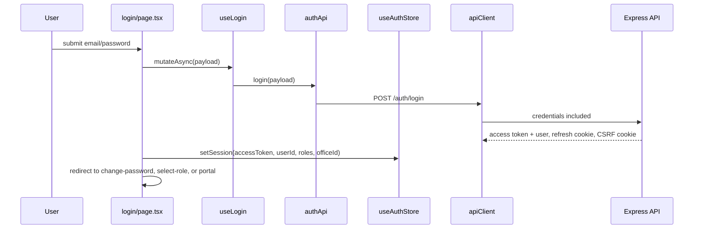

Login code from `frontend/app/(public)/login/page.tsx`:

```tsx
const payload = await loginMutation.mutateAsync({ email, password });

const normalizedRoles = normalizeRoles(payload.user.roles ?? []);
setSession({
  accessToken: payload.accessToken,
  userId: payload.user.id,
  roles: normalizedRoles,
  officeId: payload.user.office_id ?? null,
  requiresPasswordChange: !!payload.requires_password_change,
});
```

If the backend says 2FA is required, login does not store a session yet. The page switches into a 2FA state, asks for the OTP, calls `useVerify2fa`, and only then calls `setSession`.

After session storage, routing depends on role count. One role goes directly to that portal. Multiple roles go to `/select-role`, unless the original `next` path can be satisfied by a selected role.

Code from the same login page:

```tsx
if (normalizedRoles.length > 1) {
  router.push(
    nextPath
      ? `/select-role?next=${encodeURIComponent(nextPath)}`
      : "/select-role",
  );
} else {
  const singleRole = normalizedRoles[0] ?? "guest";
  router.push(
    nextPath && canAccessPathForRole(nextPath, singleRole)
      ? nextPath
      : getPortalPathForRole(singleRole),
  );
}
```

Role selection is a first-class frontend behavior, not a visual convenience. `/select-role` stores the selected role in Zustand and then forces a full page reload. The reload is intentional: it guarantees the next request has the correct `X-Selected-Role` header and clears stale component-local state.

Code from `frontend/app/select-role/page.tsx`:

```tsx
const handleSelect = (role: string) => {
  setSelectedRole(role);
  const target = nextPath && canAccessPathForRole(nextPath, role)
    ? nextPath
    : getPortalPathForRole(role);

  const basePath = process.env.NEXT_PUBLIC_BASE_PATH || '';
  const normalizedTarget = basePath && target.startsWith(basePath)
    ? target.substring(basePath.length)
    : target;
  window.location.href = `${basePath}${normalizedTarget || '/'}`;
};
```

Every API request passes through `frontend/shared/lib/api-client.ts`. The request interceptor reads the current Zustand auth state at request time, not at module-load time. That matters because selected role can change after the app has already loaded.

```ts
const applyAuthHeaders = (config: InternalAxiosRequestConfig) => {
  const { accessToken, selectedRole } = useAuthStore.getState();
  const headers =
    config.headers instanceof AxiosHeaders ? config.headers : new AxiosHeaders(config.headers ?? {});

  if (accessToken) {
    headers.set('Authorization', `Bearer ${accessToken}`);
  }

  if (selectedRole) {
    headers.set('X-Selected-Role', selectedRole);
  }

  const csrfToken = readCookie('gms_csrf_token');
  if (csrfToken) {
    headers.set('X-CSRF-Token', csrfToken);
  }

  config.headers = headers;
  return config;
};
```

When an access token expires, the response interceptor tries exactly one refresh for the failed request. It avoids refresh loops for auth endpoints, uses one shared `refreshRequest` promise so multiple simultaneous 401s do not stampede the backend, stores the new access token in Zustand, restores the selected role if still valid, and retries the original request with the new token.

Code from `frontend/shared/lib/api-client.ts`:

```ts
let refreshRequest: Promise<string> | null = null;

const refreshAccessToken = async () => {
  if (!refreshRequest) {
    refreshRequest = (async () => {
      const response = await apiClient.post('/auth/refresh');

      const payload = response.data.data as {
        accessToken: string;
        user: { id: number; roles?: string[]; office_id?: number };
      };

      const { selectedRole } = useAuthStore.getState();
      useAuthStore.getState().setSession({
        accessToken: payload.accessToken,
        userId: payload.user.id,
        roles: payload.user.roles ?? [],
        officeId: payload.user.office_id,
      });

      if (selectedRole && (payload.user.roles ?? []).includes(selectedRole)) {
        useAuthStore.getState().setSelectedRole(selectedRole);
      }

      return payload.accessToken;
    })().finally(() => {
      refreshRequest = null;
    });
  }

  return refreshRequest;
};
```

The retry branch is the important part to understand when debugging "I got logged out" reports:

```ts
if (status === 401 && requestConfig && !requestConfig._retry && !isAuthAttempt) {
  requestConfig._retry = true;

  try {
    const nextAccessToken = await refreshAccessToken();
    const headers =
      requestConfig.headers instanceof AxiosHeaders
        ? requestConfig.headers
        : new AxiosHeaders(requestConfig.headers ?? {});
    headers.set('Authorization', `Bearer ${nextAccessToken}`);
    requestConfig.headers = headers;
    return apiClient(requestConfig);
  } catch {
    useAuthStore.getState().clearSession();
  }
}
```

Logout flows the opposite direction. `PortalShell` calls `authApi.logout()`, which posts to `/auth/logout` with CSRF, then `clearSession()` removes token, roles, selected role, office ID, and password-change flag from local storage.

Auth API code from `frontend/features/auth/api.ts`:

```ts
async logout() {
  const csrfToken = readCookie('gms_csrf_token');
  const response = await apiClient.post(
    '/auth/logout',
    {},
    {
      headers: csrfToken ? { 'X-CSRF-Token': csrfToken } : undefined,
    }
  );
  return response.data.data as { loggedOut: boolean };
},
```

### React Query And Realtime

React Query is the frontend's server-state cache. Feature hooks choose query keys carefully so the same endpoint can have different cached results for different roles. `useRoleContext` builds a `scopeKey` from `userId` and active role. That scope key is included in important query keys, so a user switching from host to admin does not accidentally reuse host-scoped server data.

Code from `frontend/shared/hooks/useRoleContext.ts`:

```ts
const activeRole = selectedRole ?? roles[0] ?? 'guest';
const scopeKey = `${userId ?? 'anon'}:${activeRole}`;

return {
  roles,
  selectedRole,
  activeRole,
  effectiveRole: activeRole,
  userId,
  officeId,
  scopeKey,
  isAdmin: isAdminRole(activeRole),
  isHost: isHostRole(activeRole),
  isReception: isReceptionRole(activeRole),
  isSuperRole: activeRole.startsWith('super_'),
  isGuest: activeRole === 'guest',
};
```

Visit list hooks include this scope key:

```ts
export const useVisitsList = (params: {
  page: number;
  limit: number;
  status?: string;
  status_group?: string;
  ...
}) => {
  const { scopeKey } = useRoleContext();

  return useQuery({
    queryKey: ["visits", scopeKey, params],
    queryFn: () => visitsApi.list(params),
  });
};
```

Mutations invalidate broad prefixes such as `["visits"]` and `["operations-dashboard"]`. That is intentional. The app may have several visit queries active with different filters, pages, and role scopes. Invalidating the prefix tells React Query to mark all matching variants stale.

Example from `frontend/features/visits/hooks.ts`:

```ts
export const useCreateVisit = () => {
  const queryClient = useQueryClient();
  return useMutation({
    mutationFn: (data: {
      service_id?: number | null;
      department_id?: number | null;
      office_id: number;
      time_slot_id: number;
      host_id?: number;
      purpose?: string;
      guest_id?: number;
      guest_payload?: {
        full_name: string;
        email: string;
        phone?: string;
        company?: string;
      };
    }) => visitsApi.create(data),
    onSuccess: () => {
      queryClient.invalidateQueries({ queryKey: ["visits"] });
      queryClient.invalidateQueries({ queryKey: ["operations-dashboard"] });
      queryClient.invalidateQueries({ queryKey: ["catalog", "time-slots"] });
    },
  });
};
```

Realtime follows the same principle. A backend approval publishes a visit event through the outbox. Socket.IO emits `domain_event`. `RealtimeBridge` receives it, dispatches a local browser event for specialty listeners, and invalidates React Query caches. The host dashboard does not need to manually merge an approved visit into a local array. It simply refetches because `["visits"]` and `["operations-dashboard"]` are now stale.

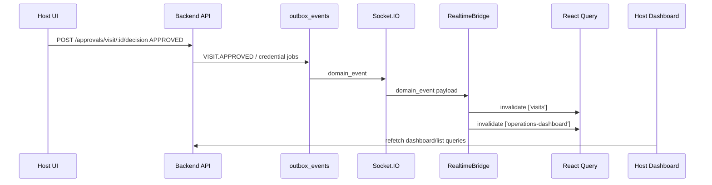

The code that performs that invalidation is in `frontend/providers/RealtimeBridge.tsx`:

```tsx
socket.on('domain_event', (payload: DomainEventPayload) => {
  const { type, metadata } = payload;
  const { pathname: currentPath, userId: currentUserId, selectedRole: currentRole } = contextRef.current;
  
  window.dispatchEvent(new CustomEvent(SOCKET_EVENT_EVENT, { detail: payload }));

  if (type.startsWith('VISIT.')) {
    queryClient.invalidateQueries({ queryKey: ['visits'] });
    queryClient.invalidateQueries({ queryKey: ['operations-dashboard'] });
    // Also invalidate all operations-dashboard queries with any scopeKey
    queryClient.invalidateQueries({ predicate: (query) => query.queryKey[0] === 'operations-dashboard' });
  }

  if (type === 'MESSAGE.SENT' && metadata.entity_id) {
    queryClient.invalidateQueries({ queryKey: ['visit-messages', Number(metadata.entity_id)] });
  }
```

The socket connection is created only after auth hydration, access token, and user ID exist. On connect, it decodes the JWT and joins the user's office room. Pages can also dispatch browser events to join office or visit rooms.

```tsx
if (!hydrated || !accessToken || !userId) return;

socket = io(socketUrl, { 
  path: socketPath, 
  auth: { token: accessToken },
  transports: ['websocket', 'polling'], // Allow fallback to polling if websocket fails
  reconnectionAttempts: 5,
  reconnectionDelay: 1000,
});

socket.on('connect', () => {
  logger.info('WebSocket connected successfully');
  const decoded = decodeJwtPayload(accessToken);
  const tokenOfficeId = Number(decoded?.office_id);
  if (Number.isFinite(tokenOfficeId) && tokenOfficeId > 0) {
    joinOffice(tokenOfficeId);
  }
});
```

Manual room joining uses `useOfficeRealtime`. It is a tiny hook that turns a list of office IDs into `gms:join-office` browser events:

```ts
export const useOfficeRealtime = (officeIds: Array<number | null | undefined>) => {
  useEffect(() => {
    const uniqueOfficeIds = [
      ...new Set(
        officeIds
          .map((value) => Number(value))
          .filter((value) => Number.isFinite(value) && value > 0)
      ),
    ];

    uniqueOfficeIds.forEach((officeId) => {
      window.dispatchEvent(new CustomEvent(JOIN_OFFICE_EVENT, { detail: { officeId } }));
    });
  }, [officeIds]);
};
```

For server data freshness, the frontend has both pull and push. Pull is React Query polling and stale-time config. Push is Socket.IO invalidation. For example, operations dashboard polling is configured in `frontend/shared/lib/query-config.ts`:

```ts
export const QC = {
  STATIC: { staleTime: 5 * 60 * 1000, gcTime: 10 * 60 * 1000 },
  DASHBOARD: { staleTime: 30_000, refetchInterval: 30_000 },
  VISITS: { staleTime: 15_000, refetchInterval: 30_000 },
  NOTIFICATIONS: { staleTime: 10_000, refetchInterval: 20_000 },
  PROFILE: { staleTime: 10 * 60 * 1000 },
} as const;
```

The result is resilient: if the socket misses an event, polling eventually corrects the UI. If polling has not fired yet, realtime gives the user a fast refresh.

### Feature Folder Convention

Feature folders are the frontend's domain modules. Most important domains follow this shape:

```text
frontend/features/<domain>/
|-- api.ts        # HTTP calls through apiClient
|-- hooks.ts      # React Query hooks and mutations
|-- types.ts      # TypeScript DTOs used by components
`-- components/   # Domain-specific UI, only when needed
```

The rule is the same as the backend rule: keep transport details away from page components. A page should call `useVisitsList`, not `apiClient.get("/visits")`. A component should receive typed data, not parse backend envelopes itself.

The visits feature is the clearest example. `api.ts` knows HTTP paths:

```ts
async updateStatus(
  id: number,
  status: string,
): Promise<{ success: boolean; data: Visit }> {
  const response = await apiClient.patch(`/visits/${id}/status`, { status });
  return response.data as { success: boolean; data: Visit };
},
```

`hooks.ts` knows cache keys and invalidation:

```ts
export const useUpdateVisitStatus = () => {
  const queryClient = useQueryClient();
  return useMutation({
    mutationFn: (payload: { id: number; status: string }) =>
      visitsApi.updateStatus(payload.id, payload.status),
    onSuccess: () => {
      queryClient.invalidateQueries({ queryKey: ["visits"] });
      queryClient.invalidateQueries({ queryKey: ["visit-detail"] });
      queryClient.invalidateQueries({ queryKey: ["operations-dashboard"] });
    },
  });
};
```

`types.ts` describes what components can rely on:

```ts
export interface Visit {
  id: number;
  reference_number: string | null;
  qr_code: string;
  scheduled_start: string;
  scheduled_end: string;
  status:
    | 'PENDING'
    | 'APPROVED'
    | 'DECLINED'
    | 'RESCHEDULED'
    | 'CHECKED_IN'
    | 'IN_PROGRESS'
    | 'COMPLETED'
    | 'CANCELLED'
    | 'EXPIRED'
    | 'NO_SHOW'
    | 'ESCALATED'
    | 'REASSIGNED'
    | 'REASSIGNED_RESCHEDULED';
```

#### Worked Example: Add A Frontend-Only Urgent Visits Panel

Suppose product asks for a host-side "Urgent visits" panel. It should show VIP visits and escalated visits using data the frontend already receives. There is no new backend endpoint. This is a frontend-only feature because we are filtering already-fetched visit data and rendering it differently.

Start by asking where the data comes from. Visits already come from `frontend/features/visits/api.ts` and `useVisitsList`. Do not call `apiClient` directly from a page. Add a small typed helper/hook in the visits feature so every page gets the same definition of "urgent."

Step 1: add frontend-only types to `frontend/features/visits/types.ts`.

```ts
export type VisitUrgencyFilter = 'all' | 'vip' | 'escalated';
```

Step 2: add a derived hook to `frontend/features/visits/hooks.ts`. It uses the existing API, keeps the existing query key, and filters in memory. Because the data is still owned by `useVisitsList`, normal visit invalidation and socket refresh still work.

```ts
export const useUrgentVisits = (filter: VisitUrgencyFilter = 'all') => {
  const visitsQuery = useVisitsList({
    page: 1,
    limit: 50,
    status_group: 'ACTIVE',
  });

  const visits = visitsQuery.data?.data ?? [];
  const urgentVisits = visits.filter((visit) => {
    if (filter === 'vip') return Boolean(visit.is_vip);
    if (filter === 'escalated') return visit.status === 'ESCALATED';
    return Boolean(visit.is_vip) || visit.status === 'ESCALATED';
  });

  return {
    ...visitsQuery,
    urgentVisits,
  };
};
```

Step 3: create a component (for example `UrgentVisitsPanel`) under `frontend/features/visits/components/`. This belongs in the feature folder because the panel is visit-specific, not a shared UI primitive.

```tsx
'use client';

import { useState } from 'react';
import { useUrgentVisits } from '@features/visits/hooks';
import type { VisitUrgencyFilter } from '@features/visits/types';

export function UrgentVisitsPanel() {
  const [filter, setFilter] = useState<VisitUrgencyFilter>('all');
  const { urgentVisits, isLoading } = useUrgentVisits(filter);

  if (isLoading) {
    return <div className="rounded-lg border border-slate-800 p-4 text-sm text-slate-400">Loading urgent visits...</div>;
  }

  return (
    <section className="space-y-3">
      <div className="flex items-center justify-between gap-3">
        <h2 className="text-sm font-semibold text-white">Urgent visits</h2>
        <select
          value={filter}
          onChange={(event) => setFilter(event.target.value as VisitUrgencyFilter)}
          className="rounded-md border border-slate-800 bg-slate-950 px-2 py-1 text-xs text-slate-200"
        >
          <option value="all">All</option>
          <option value="vip">VIP</option>
          <option value="escalated">Escalated</option>
        </select>
      </div>

      {urgentVisits.map((visit) => (
        <article key={visit.id} className="rounded-lg border border-slate-800 p-3">
          <div className="text-sm font-medium text-white">{visit.guest?.name ?? 'Guest'}</div>
          <div className="mt-1 text-xs text-slate-400">{visit.reference_number ?? `Visit #${visit.id}`}</div>
        </article>
      ))}
    </section>
  );
}
```

Step 4: wire it into a page such as `frontend/app/host/visits/page.tsx`.

```tsx
import { UrgentVisitsPanel } from '@features/visits/components/UrgentVisitsPanel';

export default function HostVisitsPage() {
  return (
    <div className="grid gap-4 xl:grid-cols-[minmax(0,1fr)_320px]">
      <HostVisitsTable />
      <UrgentVisitsPanel />
    </div>
  );
}
```

Step 5: test the refresh path. Approve or escalate a visit in another browser role. The backend emits a `VISIT.*` event, `RealtimeBridge` invalidates `["visits"]`, `useVisitsList` refetches, and the urgent panel updates because it derives from the same query data. You should not need a custom socket listener in `UrgentVisitsPanel`.

This is the main pattern for frontend-only features: reuse feature hooks, derive local display state close to the feature, and let React Query plus realtime invalidation keep the data fresh.

### Common Frontend Bugs

Stale queries after mutation usually mean the mutation invalidated the wrong key or only one exact variant. The current code has one real example: `useVisitById` uses `["visits", id, scopeKey]`, while several mutations invalidate `["visit-detail"]`. The broad `["visits"]` invalidation covers many cases, but if a future detail page ever changes to a separate key, keep the hook key and mutation invalidation aligned.

Actual detail hook:

```ts
export const useVisitById = (id: number) => {
  const { scopeKey } = useRoleContext();

  return useQuery({
    queryKey: ["visits", id, scopeKey],
    queryFn: () => visitsApi.getById(id),
    enabled: !!id,
  });
};
```

Wrong selected role bugs show up as "the backend says forbidden even though the user has the role." The frontend sends `X-Selected-Role` on every request if `selectedRole` is set. If a multi-role user is currently acting as `host`, the backend intentionally evaluates the request as host only. Fix the selected role, not the backend permission check.

Header code:

```ts
if (selectedRole) {
  headers.set('X-Selected-Role', selectedRole);
}
```

Socket room bugs show up as "the page only updates after polling, not immediately." First check whether the socket exists: `RealtimeBridge` will not connect until `hydrated`, `accessToken`, and `userId` are all present. Then check whether the socket joined the right room. Office room joining depends on `office_id` inside the JWT, while visit-room joining depends on a page dispatching `gms:join-visit`.

Room join listener from `RealtimeBridge`:

```tsx
const onJoinVisit = (event: Event) => {
  const customEvent = event as CustomEvent<{ visitId?: number }>;
  const visitId = Number(customEvent.detail?.visitId);
  if (Number.isFinite(visitId) && visitId > 0) joinVisitRoom(visitId);
};
```

Auth hydration bugs show up as a flash of login or a redirect loop on reload. Guards must respect `hydrated`. If you write a new guard, copy the RoleGate pattern: do nothing until hydration is complete, then decide.

Base URL bugs show up mostly in production-like deployments. In local browser development, `resolveApiBaseUrl()` forces the API to the same loopback hostname on port `7200`. In production, it uses `NEXT_PUBLIC_API_BASE_URL` if present, otherwise falls back to `${basePath}/api/v1`.

Code from `frontend/shared/lib/api-base-url.ts`:

```ts
export const resolveApiBaseUrl = (options: ResolveApiBaseUrlOptions = {}) => {
  if (shouldForceLocalDevApi()) {
    return `http://${window.location.hostname}:7200/api/v1`;
  }

  const explicit =
    process.env.NEXT_PUBLIC_API_BASE_URL ??
    process.env.NEXT_PUBLIC_API_URL ??
    process.env.API_BASE_URL;

  if (explicit) {
    return trimTrailingSlash(explicit);
  }
```

Finally, remember that realtime cleanup has a known issue already called out in Chapter 11: `RealtimeBridge` removes a newly-created noop listener instead of the original event handlers. If you work on sockets, fix cleanup using stable function references. That is frontend tech debt, not backend behavior.

---

## Appendix

### Markdown And Documentation Files

| File | Description |
|---|---|
| `README.md` | Root overview and quick project orientation. |
| `CONTRIBUTING.md` | Contribution and workflow guide. |
| _(none)_ | **The `docs/` tree this table described does not exist and, as far as the git history shows, never did in this repo.** `docs/` contains `TEST_STATUS.md` only. The table was removed on 2026-09-06 rather than left as a map of somewhere else. The documentation that does exist is listed in `README.md`. |
| `backend/src/modules/auth/README.md` | Auth module notes. |
| `backend/src/modules/visits/README.md` | Visits module notes. |
| `backend/src/modules/operations/README.md` | Operations module notes. |
| `backend/src/core/db/migrations/README.md` | Migration notes. |

### Config Files

| File | Controls |
|---|---|
| `package.json` | Root monorepo scripts. |
| `backend/package.json` | Backend scripts, dependencies, Node engine. |
| `frontend/package.json` | Frontend scripts, dependencies, Node engine. |
| `docker-compose.dev.yml` | Local Postgres/Redis. |
| `docker-compose.yml` | Full stack: DB, Redis, backend, worker, frontend. |
| `backend/Dockerfile` | Backend image build/run. |
| `frontend/Dockerfile` | Frontend standalone image. |
| `backend/deploy/ecosystem.config.js` | PM2 process definitions (optional). Read its header before using it. |
| `.github/workflows/phase2-validation.yml` | CI pipeline. |
| `backend/jest.config.js` | Jest/ts-jest setup. |
| `backend/tsconfig.json` | Backend TypeScript config. |
| `frontend/tsconfig.json` | Frontend TypeScript config. |
| `frontend/next.config.js` | Next.js config. |
| `frontend/tailwind.config.js` | Tailwind config. |
| `frontend/postcss.config.js` | PostCSS config. |
| `backend/.env.example` | Backend env template. |
| `frontend/.env.example` | Frontend env template. |
| `backend/.sequelizerc` | Sequelize CLI paths. |
| `backend/src/core/db/config/config.js` | Sequelize CLI DB config. |
| `backend/deploy/ecosystem.config.js` | Backend PM2 config. |

### Scripts And Commands

Root:

| Command | Meaning |
|---|---|
| `npm run setup:env` | Generate/check backend and frontend env files. |
| `npm run dev:infra` | Start dev Postgres/Redis. |
| `npm run dev:infra:down` | Stop dev infra. |
| `npm run docker:up` | Build/start full Docker stack with production env. |
| `npm run docker:down` | Stop full Docker stack. |
| `npm run test` / `test:all` / `test:ci` | Run repo test orchestration. |
| `npm run test:backend` | Backend Jest. |
| `npm run test:frontend` | Frontend node test. |

Backend:

| Command | Meaning |
|---|---|
| `npm run dev` | Run API with nodemon and env loader. |
| `npm run build` | Compile TypeScript. |
| `npm run start` | Run compiled production API. |
| `npm run outbox:worker` | Run compiled worker. |
| `npm run outbox:worker:dev` | Run worker in development. |
| `npm test` | Jest suite. |
| `npm run test:coverage` | Jest with coverage. |
| `npm run test:openapi-coverage` | Validate OpenAPI route coverage. |
| `npm run migrate` / `migrate:prod` | Run migrations. |
| `npm run migrate:undo` / `migrate:undo:all` | Undo migrations. |
| `npm run seed:core` | Seed core data. |
| `npm run seed:demo` | Seed demo data. |
| `npm run seed:staff` | Seed staff data. |
| `npm run db:wipe` | Wipe dev DB. |
| `npm run db:fresh` | Wipe, migrate, seed core. |
| `npm run db:audit:org` | Audit org integrity. |
| `npm run db:backup` | Backup dev DB. |
| `npm run simulate` | Run simulation engine. |
| `npm run env:check:prod` | Validate production env presence. |
| `npm run webpush:keygen` | Generate VAPID keys. |
| `npm run pm2:*` | PM2 lifecycle. |
| `npm run deploy:manual` | Build and reload/start API with PM2. |

Frontend:

| Command | Meaning |
|---|---|
| `npm run dev` | Start Next dev server with env loader. |
| `npm run build` | Build Next app. |
| `npm run build:docker` | Production build via env loader. |
| `npm run start` | Start production Next. |
| `npm run start:standalone` | Start standalone mode. |
| `npm run lint` | Next lint command. |
| `npm run env:check:prod` | Validate frontend prod env. |

### Glossary

| Term | Meaning |
|---|---|
| GMS | Guest/Visitor Management System. |
| Visit | The central scheduled guest appointment and lifecycle record. |
| Host | Staff member assigned to receive a guest. |
| Reception | Staff role operating arrivals/check-in/escalations. |
| Super role | Global role variant such as `super_admin`, not office-scoped. |
| Office scope | Restriction tying staff visibility/actions to `office_id`. |
| Time slot | Concrete bookable availability window for a host. |
| Recurring availability | Rule that generates concrete time slots. |
| Outbox | Table storing events/jobs transactionally for later processing. |
| EventBus | In-process pub/sub used after outbox events are claimed. |
| BullMQ | Redis-backed job queue library. |
| SLA | Service-level deadline for host/reception response. |
| No-show | Approved visit whose guest did not check in within expected window. |
| Credential | QR/PIN/UniFi access artifact for a visit. |
| UniFi Access | External physical access-control system integration. |
| VAPID | Web Push key mechanism. |
| Idempotency key | Client-supplied key used to replay/guard duplicate POSTs. |
| DTO | Data Transfer Object returned to clients. |
| Paranoid model | Sequelize soft-delete model using `deleted_at`. |

### Final Self-Check

This document covers the executable entry points, middleware order, route surface, data models and associations, lifecycle state machine, business domains, outbox and worker flow, realtime behavior, frontend route/layout/auth/cache architecture, env/config, deployment, tests, and known drift. A junior developer should be able to start from the north star - "trace the visit" - and then locate the exact route, service, model, worker, frontend store, feature hook, and page involved in a change.
